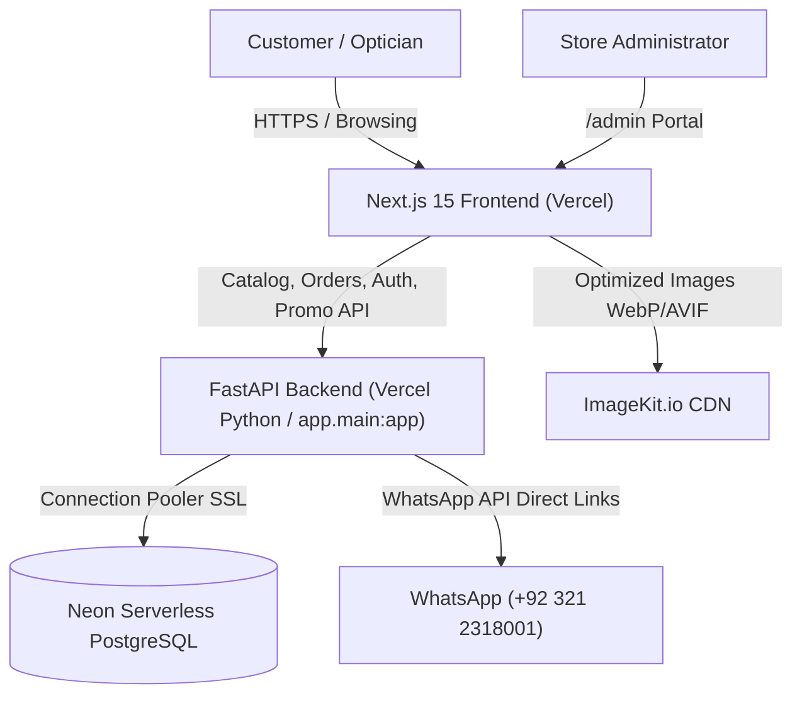

# Rida Optical — Enterprise E-Commerce Platform

A high-performance, decoupled optical e-commerce platform migrating the live WooCommerce store [ridaoptical.com](https://ridaoptical.com) to a modern, cloud-native architecture:

- **Frontend:** **Next.js 15** (App Router, React 19, TypeScript, Tailwind CSS, Zustand)
- **Backend:** **FastAPI** (Python 3.13, SQLModel ORM, Pydantic v2, `app` package dir)
- **Database:** **Neon Serverless PostgreSQL** (Connection pooling, auto-scaling)
- **Media CDN:** **ImageKit.io** (Real-time responsive WebP/AVIF transformation)
- **Deployment Target:** **Vercel** (Frontend Next.js + Backend `@vercel/python`)

---

## Architecture Overview



---

## Key Features

1. **Optical 4-Step Prescription Builder:**
   - Step 1: Lens Usage Type (Single Vision, Bifocal Round, Bifocal D, Progressive)
   - Step 2: Lens Coating (15 specialized coatings: Blue Cut, Anti-Glare, Photochromic, Drive Digital)
   - Step 3: Prescription Input (Sphere, Cylinder, Axis, Pupillary Distance OD/OS + prescription text/photo)
   - Step 4: Instant price calculation in PKR with frame + optical surcharges
2. **Pakistani E-Commerce Localization:**
   - Cash on Delivery (COD) nationwide flat shipping (PKR 349).
   - Automated WhatsApp order routing with itemized line items and customer delivery address prefilled.
3. **Promotions & Coupon Engine:**
   - Active discount codes (`OFF10`, `RIDA10`) with minimum subtotal requirements and instant cart deduction.
4. **Admin Control Center (`/admin`):**
   - KPI Statistics: Total Orders, Pending COD, Dispatched, Total Revenue (PKR).
   - Orders Management: Live search, status badge filter, TCS/Leopards courier tracking number updates, and direct customer WhatsApp links.
   - Products Catalog: Add, edit, and delete optical frames with color swatches, prices, and stock status.

---

## Repository Structure

```
.
├── backend/                  # FastAPI Application (uses "app" package dir)
│   ├── alembic/              # Database schema migrations
│   ├── app/                  # Main Python package
│   │   ├── api/v1/           # API routes (products, categories, optical, orders, auth, coupons, admin)
│   │   ├── core/             # Configuration, security (bcrypt, JWT), database engine
│   │   ├── data/             # Loader and in-memory cache sync
│   │   ├── models/           # SQLModel database models (Product, Order, Customer, Category, etc.)
│   │   └── schemas/          # Pydantic v2 validation schemas
│   ├── data/                 # Seed JSON files (products, categories, optical options)
│   ├── tests/                # 34 automated pytest unit & integration tests
│   ├── requirements.txt      # Python dependencies
│   ├── vercel.json           # Vercel Python runtime configuration (@vercel/python)
│   └── .env.example          # Environment variables template
│
├── frontend/                 # Next.js 15 App Router Application
│   ├── app/                  # App routes (/, /store, /category, /product, /cart, /checkout, /admin)
│   ├── components/           # UI components (Navbar, Footer, PDP configurator, CartDrawer, etc.)
│   ├── lib/                  # Zustand store, typed API client, ImageKit builders, utilities
│   ├── types/                # TypeScript interfaces
│   ├── package.json          # Node dependencies
│   └── .env.example          # Frontend environment variables template
│
└── documentation/            # Comprehensive 15-phase migration logs & architecture specifications
    ├── DATABASE_ARCHITECTURE.md
    ├── DATA_MIGRATION_REPORT.md
    ├── ECOMMERCE_FUNCTIONALITY.md
    ├── TESTING_AND_QA.md
    └── MIGRATION_ROADMAP.md
```

---

## Vercel Deployment Guide

### Deploying to Vercel (Two-Project Setup)

For decoupled stacks, deploying frontend and backend as two linked projects from this repository is the recommended best practice:

#### 1. Backend API (`api.ridaoptical.com` or Vercel URL)
1. In Vercel, click **Add New... -> Project** and select this GitHub repository.
2. Under **Root Directory**, click Edit and select `backend`.
3. Set **Framework Preset** to `Other`.
4. Under **Environment Variables**, add:
   - `DATABASE_URL`: Your Neon PostgreSQL pooler connection string (`postgresql://...sslmode=require`)
   - `SECRET_KEY`: A secure random secret string for JWT generation
   - `ALGORITHM`: `HS256`
   - `ACCESS_TOKEN_EXPIRE_MINUTES`: `10080`
   - `CORS_ORIGINS`: `https://ridaoptical.com,https://your-frontend.vercel.app,http://localhost:3000`
   - `IMAGEKIT_ENDPOINT`: `https://ik.imagekit.io/ridaoptical`
5. Click **Deploy**. Vercel will install dependencies from `requirements.txt` and launch `app/main.py` via `@vercel/python`.

#### 2. Frontend Storefront (`ridaoptical.com` or Vercel URL)
1. In Vercel, click **Add New... -> Project** and select this GitHub repository.
2. Under **Root Directory**, click Edit and select `frontend`.
3. Set **Framework Preset** to `Next.js`.
4. Under **Environment Variables**, add:
   - `NEXT_PUBLIC_APP_URL`: Your frontend domain (e.g. `https://ridaoptical.com`)
   - `NEXT_PUBLIC_API_URL`: Your deployed backend URL from step 1 (e.g. `https://api.ridaoptical.com` or `https://backend-xxx.vercel.app`)
   - `NEXT_PUBLIC_IMAGEKIT_ENDPOINT`: `https://ik.imagekit.io/ridaoptical`
   - `NEXT_PUBLIC_IMAGEKIT_PUBLIC_KEY`: `public_DywwNpn2M/i2ZrmGNXhLKMExcTo=`
   - `NEXT_PUBLIC_USE_IMAGEKIT`: `true`
   - `NEXT_PUBLIC_STORE_PHONE`: `+923212318001`
5. Click **Deploy**. Vercel will build 57 static SSG pages and optimize client bundles.

---

## Local Development

### Prerequisites
- Node.js 20+ & npm
- Python 3.12+
- Neon PostgreSQL connection string

### Backend Setup
```bash
cd backend
python -m venv venv
# On Windows:
venv\Scripts\activate
# On macOS/Linux:
source venv/bin/activate

pip install -r requirements.txt
cp .env.example .env
# Configure DATABASE_URL and SECRET_KEY in .env

# Run FastAPI dev server:
uvicorn app.main:app --reload --port 8000
```
API Documentation will be live at: [http://localhost:8000/docs](http://localhost:8000/docs)

### Frontend Setup
```bash
cd frontend
npm install
cp .env.example .env.local
# Set NEXT_PUBLIC_API_URL="http://localhost:8000" in .env.local

# Run Next.js dev server:
npm run dev
```
Storefront will be live at: [http://localhost:3000](http://localhost:3000)

---

## Running Tests

### Backend Unit & Integration Tests (Pytest)
```bash
cd backend
python -m pytest tests -v
# 34 tests passing (100% success rate)
```

### Frontend Production Build Test
```bash
cd frontend
npm run build
# 57 SSG static routes compiled with 0 errors
```

---

## Security & Compliance

- **Zero Credential Leakage:** All secrets, database URLs, and API keys are strictly excluded via `.gitignore` (`.env`, `.env.*`, `*.local`).
- **SQL Injection Prevention:** SQLModel parameterized statement construction.
- **Password Security:** Salted `bcrypt` password hashing (12 rounds).
- **Authentication:** `HS256` HMAC JWT bearer token authorization for administrative operations.

---

## License
Proprietary — Built for Rida Optical.
