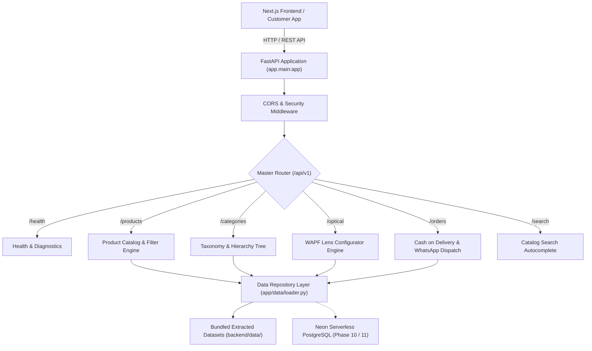

# Rida Optical — FastAPI Backend Development Architecture (Phase 9)

> **Platform:** Python 3.13 + FastAPI 0.123 + Pydantic v2 + Starlette  
> **Package Convention:** `app` package directory structure (`uvicorn app.main:app`)  
> **Deployment Target:** Vercel Python Runtime (`@vercel/python`)  
> **Database Target:** Neon Serverless PostgreSQL (Prepared for Phase 10)  
> **Test Status:** 20 / 20 Unit & Integration Tests Passing (0.13s execution)

---

## 1. System Overview & Technology Stack

The Rida Optical modern backend has been engineered inside `backend/` as a decoupled high-performance Python REST API replacing legacy WordPress PHP and WooCommerce REST endpoints.



---

## 2. Directory Structure

In accordance with user preferences and Vercel standards, the backend utilizes `app` as its primary package directory (`uvicorn app.main:app`):

```
backend/
├── app/
│   ├── __init__.py
│   ├── main.py                          # FastAPI application factory, CORS, routes
│   ├── core/
│   │   ├── __init__.py
│   │   └── config.py                    # Pydantic BaseSettings, CORS origins, defaults
│   ├── data/
│   │   ├── __init__.py
│   │   └── loader.py                    # High-performance repository, caching & order math
│   ├── schemas/
│   │   ├── __init__.py
│   │   ├── common.py                    # APIResponse, PaginatedResponse, PaginationMeta
│   │   ├── product.py                   # Product, variation, filter & SEO schemas
│   │   ├── category.py                  # Flat & nested CategoryTreeSchema
│   │   ├── optical.py                   # WAPF lens usage, coating & prescription schemas
│   │   └── order.py                     # OrderCreate, OrderResponse, OrderItemDetail
│   └── api/
│       ├── __init__.py
│       └── v1/
│           ├── __init__.py
│           ├── router.py                # Master API v1 router
│           └── endpoints/
│               ├── __init__.py
│               ├── health.py            # System health check
│               ├── products.py          # Products list, filter, detail
│               ├── categories.py        # Categories list & hierarchy
│               ├── optical.py           # 4-Step optical options & 15 coatings
│               ├── orders.py            # Checkout submission & order lookup
│               └── search.py            # Instant autocomplete search
├── data/
│   ├── products.json                    # 17 published products & 44 variations
│   ├── categories.json                  # 27 taxonomy categories
│   └── optical_options.json             # WAPF lens selector options & 15 coatings
├── tests/
│   ├── __init__.py
│   ├── conftest.py                      # Starlette TestClient fixture
│   ├── test_health.py                   # Health endpoint tests
│   ├── test_products.py                 # Products filtering & pagination tests
│   ├── test_categories.py               # Taxonomy & tree tests
│   ├── test_optical.py                  # Optical options & coating price tests
│   └── test_orders.py                   # Order calculation & WhatsApp URL tests
├── .env.example                         # Environment variables template (Zero secrets)
├── pytest.ini                           # Pytest configuration
├── requirements.txt                     # Locked dependencies
├── vercel.json                          # Vercel serverless deployment config
└── README.md                            # Local setup & running instructions
```

---

## 3. API Endpoints Specification

### A. Health & Diagnostics
- `GET /` — Root API information, documentation links, and route directory.
- `GET /api/v1/health` (also `/api/health`) — Checks service status, catalog counts (17 products, 27 categories, 15 coatings, 4 usage types).

### B. Products Catalog
- `GET /api/v1/products` — Paginated list with extensive filter parameters:
  - `category`: Category slug (e.g. `eye-glasses`, `sunglasses`)
  - `q`: Search query matching model name, SKU, or variation colors
  - `min_price` & `max_price`: Frame price range filter in PKR
  - `color`: Variation color filter (e.g. `Silver`, `Green`, `Golden`)
  - `in_stock_only`: Boolean filter for available inventory
  - `has_prescription`: Filter frames with prescription lens support
  - `sort_by`: `featured`, `price_asc`, `price_desc`, `title_asc`
  - `page` & `page_size`: Pagination parameters
- `GET /api/v1/products/featured` — Top bestseller frames.
- `GET /api/v1/products/{slug_or_id}` — Single product details with all 44 variations, swatches, images, description, and SEO metadata.

### C. Categories
- `GET /api/v1/categories` — List categories (supports `?parent_only=true` and `?tree=true` for nested hierarchies).
- `GET /api/v1/categories/{slug_or_id}` — Single category by slug or ID.

### D. Optical Customization (WAPF Parity)
- `GET /api/v1/optical/options` — Complete 4-step configuration:
  - Notice alert message regarding high cylinders / progressive lenses.
  - Step 1: 4 Vision Usage Types (`single-vision`, `bifocal-round-segment`, `bifocal-d-segment`, `progressive`).
  - Step 2: 15 Lens Coatings with exact PKR surcharges (+Rs. 1,300 to +Rs. 3,500).
  - Step 3: Prescription input configuration (Text + Doctor Slip upload).
- `GET /api/v1/optical/coatings` — Filterable by category (`clear`, `blue_cut`, `photochromic`, `driving`, `tinted`, `polycarbonate`).
- `GET /api/v1/optical/usage-types` — List usage options.

### E. Orders & Checkout
- `POST /api/v1/orders` — Accepts structured order payload:
  - Validates customer contact & shipping address in Pakistan.
  - Resolves frame base price + active color variation.
  - Calculates optical surcharge for selected lens coating.
  - Applies flat rate nationwide shipping fee of **PKR 349.0**.
  - Generates unique `#RO-XXXXX` order number.
  - Automatically compiles a pre-formatted WhatsApp direct checkout URL to `+923212318001`.
- `GET /api/v1/orders/{order_id}` — In-memory order tracking lookup.

### F. Search Autocomplete
- `GET /api/v1/search?q={term}` — Fast indexed search across model names, SKUs, colors, and descriptions.

---

## 4. Test Suite Verification

The backend was verified against an automated test suite covering all routers:

```
============================= test session starts =============================
platform win32 -- Python 3.13.5, pytest-8.2.2, pluggy-1.6.0
rootdir: E:\rida opt\Rida-Optical-Migration\backend
configfile: pytest.ini
collected 20 items

tests/test_categories.py::test_list_all_categories PASSED                [  5%]
tests/test_categories.py::test_list_parent_categories PASSED             [ 10%]
tests/test_categories.py::test_category_tree PASSED                      [ 15%]
tests/test_categories.py::test_get_single_category PASSED                [ 20%]
tests/test_health.py::test_root_endpoint PASSED                          [ 25%]
tests/test_health.py::test_health_endpoint PASSED                        [ 30%]
tests/test_optical.py::test_get_optical_options PASSED                   [ 35%]
tests/test_optical.py::test_get_lens_coatings PASSED                     [ 40%]
tests/test_optical.py::test_get_lens_coatings_filter_category PASSED     [ 45%]
tests/test_optical.py::test_get_usage_types PASSED                       [ 50%]
tests/test_orders.py::test_create_order_frame_only PASSED                [ 55%]
tests/test_orders.py::test_create_order_with_prescription_lenses PASSED  [ 60%]
tests/test_orders.py::test_search_endpoint PASSED                        [ 65%]
tests/test_products.py::test_list_products_default PASSED                [ 70%]
tests/test_products.py::test_list_products_category_filter PASSED        [ 75%]
tests/test_products.py::test_list_products_price_sort PASSED             [ 80%]
tests/test_products.py::test_get_featured_products PASSED                [ 85%]
tests/test_products.py::test_get_product_detail_success PASSED           [ 90%]
tests/test_products.py::test_get_product_detail_by_id PASSED             [ 95%]
tests/test_products.py::test_get_product_not_found PASSED                [100%]

============================= 20 passed in 0.13s ==============================
```

---

## 5. Deployment Model (Vercel + Python)

Pre-configured in [`backend/vercel.json`](file:///E:/rida%20opt/Rida-Optical-Migration/backend/vercel.json):
```json
{
  "version": 2,
  "builds": [
    {
      "src": "app/main.py",
      "use": "@vercel/python"
    }
  ],
  "routes": [
    {
      "src": "/(.*)",
      "dest": "app/main.py"
    }
  ]
}
```
Vercel serverless functions load `app.main:app` with sub-second cold starts.
