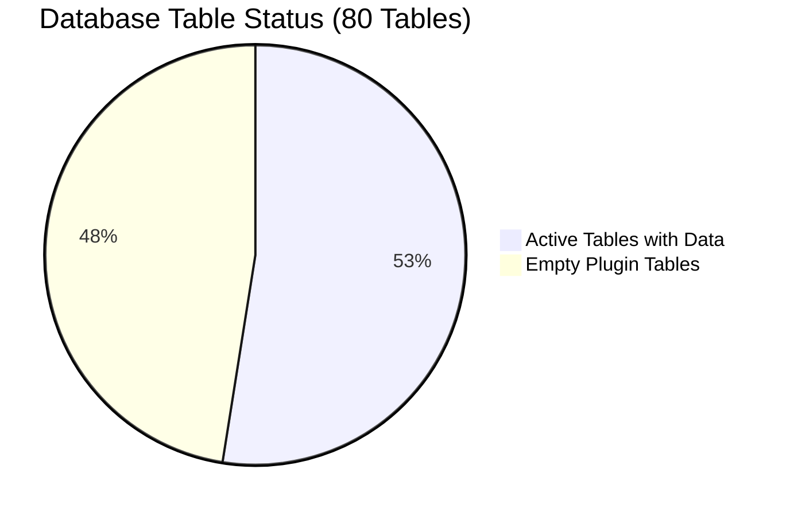
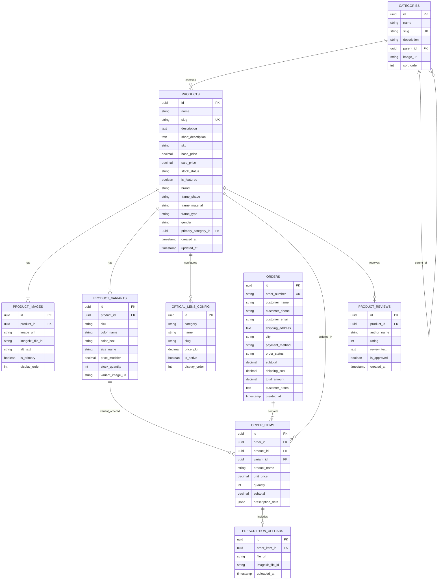

# Rida Optical — WordPress Database Technical Analysis

> **Analysis Scope:** Complete profiling of MySQL database backup (`reference/live-database.sql.gz`)  
> **Source Platform:** WordPress 7.0.8 + WooCommerce 11.2.1 (MySQL 5.5.5+ / utf8mb4)  
> **Target Database:** Neon Serverless PostgreSQL 16+ via SQLModel / Alembic  
> **Security Protocol:** Zero credential exposure, customer PII isolated, read-only inspection

---

## 1. Executive Summary & Database Metrics

| Metric | Source Dump Value | Architectural Implication |
| :--- | :--- | :--- |
| **Total Database Tables** | **80 tables** | 42 active tables with data; 38 completely empty plugin tables |
| **Total SQL Statements / Lines** | **23,054 lines** | Compact, high-signal database |
| **Total Metadata Records (`wp_postmeta`)** | **5,885 rows** (12.9 MB) | Core repository for optical attributes, prices, and media links |
| **Total Post Records (`wp_posts`)** | **706 rows** | 17 published products, 44 variations, 313 media attachments, 12 pages |
| **Active Store Currency** | **PKR** (Pakistani Rupee) | Decimal precision 2, symbol positioned left |
| **Primary Order Channel** | **COD & WhatsApp Chat** | 1 test completed WooCommerce order; primary store operations via WhatsApp |
| **Database Charset & Collation** | `utf8mb4` / `utf8mb4_unicode_520_ci` | Direct, 100% loss-free compatibility with PostgreSQL `UTF-8` |

---

## 2. Complete Inventory of All 80 Database Tables

### Table Inventory with Exact Row Counts & Storage

| Table Name | Row Count | Dump Size (KB) | Domain / Category | Migration Strategy |
| :--- | :--- | :--- | :--- | :--- |
| `wp_actionscheduler_logs` | 7,485 | 633.3 KB | WP Cron Logging | **DROP** (WordPress internal log) |
| `wp_postmeta` | 5,885 | 12,913.5 KB | WordPress Core Metadata | **MIGRATE** (Extract attributes, prices, media) |
| `wp_actionscheduler_actions` | 2,502 | 1,096.7 KB | WP Cron Tasks | **DROP** (WordPress internal scheduler) |
| `wp_options` | 1,568 | 4,569.2 KB | Site & Plugin Settings | **MIGRATE** (Extract settings & configs) |
| `wp_posts` | 706 | 917.1 KB | Core Content & Products | **MIGRATE** (Products, pages, media, optical fields) |
| `wp_aioseo_posts` | 359 | 321.6 KB | SEO Titles & Meta | **MIGRATE** (Preserve 1:1 SEO meta parity) |
| `wp_termmeta` | 258 | 29.5 KB | Category & Term Meta | **MIGRATE** (Category banners, swatches) |
| `wp_woocommerce_order_itemmeta` | 253 | 8.6 KB | Order Item Meta | **MIGRATE / ARCHIVE** (Order history) |
| `wp_term_relationships` | 185 | 2.5 KB | Taxonomy Associations | **MIGRATE** (Product-to-category mappings) |
| `wp_wc_admin_note_actions` | 171 | 31.3 KB | WooCommerce Admin Alert | **DROP** (Admin UI notifications) |
| `wp_wc_admin_notes` | 136 | 58.9 KB | WooCommerce Admin Notes | **DROP** (Admin UI notifications) |
| `wp_comments` | 121 | 48.4 KB | Reviews & Order Notes | **MIGRATE** (Extract product reviews & ratings) |
| `wp_usermeta` | 102 | 97.5 KB | User Capabilities & Meta | **MIGRATE** (Admin user profiles) |
| `wp_term_taxonomy` | 99 | 3.1 KB | Taxonomy Classification | **MIGRATE** (Categories, colors, sizes) |
| `wp_terms` | 99 | 3.2 KB | Taxonomy Term Names | **MIGRATE** (Category names, slugs) |
| `wp_wc_product_meta_lookup` | 61 | 4.8 KB | WC Product Lookup Table | **TRANSFORM** (Normalized product attributes) |
| `wp_wc_category_lookup` | 47 | 0.5 KB | WC Category Tree Lookup | **TRANSFORM** (Hierarchical category table) |
| `wp_wc_product_attributes_lookup`| 47 | 1.5 KB | WC Attribute Lookup | **TRANSFORM** (Product color & size variants) |
| `wp_aioseo_notifications` | 36 | 1,278.8 KB | SEO Admin Notifications | **DROP** (AIOSEO admin alerts) |
| `wp_cartflows_ca_email_templates_meta` | 27 | 0.8 KB | CartFlows Recovery Meta | **DROP / REFERENCE** |
| `wp_woocommerce_order_items` | 25 | 1.0 KB | Order Line Items | **MIGRATE / ARCHIVE** |
| `wp_wpforms_logs` | 22 | 2.1 KB | Contact Form Logs | **DROP** (Historical form logs) |
| `wp_actionscheduler_groups` | 19 | 0.5 KB | ActionScheduler Groups | **DROP** |
| `wp_aioseo_cache` | 16 | 32.1 KB | SEO Cache Data | **DROP** (Transient cache) |
| `wp_commentmeta` | 16 | 0.6 KB | Comment Ratings | **MIGRATE** (5-star review ratings) |
| `wp_wc_orders_meta` | 14 | 0.9 KB | High-Performance Order Meta | **MIGRATE / ARCHIVE** |
| `wp_cartflows_ca_cart_abandonment` | 13 | 31.7 KB | Abandoned Carts Log | **REFERENCE** (Historical recovery log) |
| `wp_snippets` | 7 | 3.8 KB | Custom PHP/JS Snippets | **TRANSFORM** (Converted to React / Next.js) |
| `wp_wpforms_tasks_meta` | 6 | 0.4 KB | Form Task Meta | **DROP** |
| `wp_cartflows_ca_email_templates` | 3 | 1.7 KB | Cart Recovery Templates | **REFERENCE** |
| `wp_wc_product_download_directories` | 2 | 0.2 KB | Digital Downloads Config | **DROP** (Physical optical store) |
| `wp_wc_tax_rate_classes` | 2 | 0.1 KB | Tax Classes | **DROP** (Tax disabled in store) |
| `wp_woocommerce_attribute_taxonomies` | 2 | 0.1 KB | Attribute Definitions | **MIGRATE** (`pa_color`, `pa_size`) |
| `wp_users` | 1 | 0.2 KB | Store Administrator | **MIGRATE** (Superadmin account) |
| `wp_wc_customer_lookup` | 1 | 0.1 KB | Customer Index | **MIGRATE / ARCHIVE** |
| `wp_wc_order_addresses` | 1 | 0.1 KB | Order Shipping Address | **MIGRATE / ARCHIVE** |
| `wp_wc_order_operational_data` | 1 | 0.2 KB | Order Operational Meta | **MIGRATE / ARCHIVE** |
| `wp_wc_order_product_lookup` | 1 | 0.1 KB | Order Product Lookup | **MIGRATE / ARCHIVE** |
| `wp_wc_order_stats` | 1 | 0.1 KB | Order Analytics Stats | **MIGRATE / ARCHIVE** |
| `wp_wc_orders` | 1 | 0.3 KB | Completed Order Record | **MIGRATE / ARCHIVE** |
| `wp_woocommerce_shipping_zone_locations` | 1 | 0.0 KB | Shipping Zone Locations | **MIGRATE** (Pakistan zones) |
| `wp_woocommerce_shipping_zone_methods` | 1 | 0.0 KB | Shipping Methods (Flat rate) | **MIGRATE** (Free delivery / flat rate) |
| `wp_woocommerce_shipping_zones` | 1 | 0.0 KB | Shipping Zones | **MIGRATE** (Default Pakistan zone) |
| *38 Empty Tables (0 rows)* | 0 | 0.0 KB | Unused plugins / utilities | **DROP** (No data) |

---

## 3. WordPress EAV Anti-Pattern vs PostgreSQL Normalized Target

In WordPress, product attributes, prices, images, stock, and variations are stored across an **Entity-Attribute-Value (EAV)** model in `wp_postmeta`:
- Single product record requires **40+ separate SQL rows** in `wp_postmeta`.
- Complex multi-attribute queries require multiple self-joins against a 12.9 MB table.

### Target Relational Transformation (Neon PostgreSQL)

---

## 4. Optical Lens Data Architecture (PostgreSQL Ready)

The optical lens selection system from `wapf_product` (Post ID **4620**) will be normalized into the `OPTICAL_LENS_CONFIG` table with two distinct categories:

### A. Vision Usage Types (`category = 'vision_type'`)
| Name | Slug | Price Modifier (PKR) | Notes |
| :--- | :--- | :--- | :--- |
| Single Vision | `single-vision` | +Rs. 0 | Standard single vision distance or reading |
| Bifocal Round Segment | `bifocal-round` | +Rs. 0 | Visible round bifocal segment |
| Bifocal D Segment | `bifocal-d` | +Rs. 0 | Straight-top D-segment bifocal |
| Progressive | `progressive` | +Rs. 0 | Multi-focal seamless lens |

### B. Lens Coatings & Treatments (`category = 'lens_coating'`)
| Name | Slug | Price (PKR) | Technology / Feature |
| :--- | :--- | :--- | :--- |
| Clear Standard | `clear-standard` | **+Rs. 1,300** | Standard anti-reflective clear coating |
| Clear Premium | `clear-premium` | **+Rs. 1,800** | High-index ultra-thin clear lens |
| Tinted Standard | `tinted-standard` | **+Rs. 1,600** | 100% UV400 sunglasses tint |
| Tinted Premium | `tinted-premium` | **+Rs. 2,300** | Polarized UV400 premium tint |
| Screen Standard | `screen-standard` | **+Rs. 1,700** | Anti-blue ray digital filter |
| Screen Premium | `screen-premium` | **+Rs. 2,600** | High-grade anti-glare blue-light blocker |
| Transition Standard | `transition-standard` | **+Rs. 2,300** | Photochromic sun-activated tint |
| Transition Premium | `transition-premium` | **+Rs. 3,450** | Fast-fading active photochromic |
| Transition Screen Standard | `transition-screen-std`| **+Rs. 2,350** | Photochromic + Blue-cut dual coating |
| Transition Screen Premium | `transition-screen-prem`| **+Rs. 3,150** | Premium photochromic + blue-cut |
| Drive Clear | `drive-clear` | **+Rs. 3,000** | Night-driving anti-glare coating |
| Drive Digital | `drive-digital` | **+Rs. 3,500** | Digital anti-fatigue driving lens |
| Drive Transition | `drive-transition` | **+Rs. 3,500** | Driving contrast tint with photochromic |
| Unbreakable Tinted | `unbreakable-tinted` | **+Rs. 2,000** | Impact-resistant polycarbonate sunglasses |
| Unbreakable Transition | `unbreakable-transition`| **+Rs. 3,450** | Impact-resistant photochromic polycarbonate |

---

## 5. SEO Parity Table (`wp_aioseo_posts`)

The live website utilizes **All in One SEO (AIOSEO)** (`wp_aioseo_posts`, 359 records). Key fields that will be extracted directly into PostgreSQL `seo_metadata` include:

1. `title`: Exact custom SERP title template (e.g. `Maybach Premium Rimless Eyeglass Frame - Rida Optical`).
2. `description`: Custom meta description snippets for Google SERP cards.
3. `canonical_url`: Canonical URL to avoid duplicate content penalties.
4. `focus_keyword`: Primary target keyword for the page or product.
5. `og_title`, `og_description`, `og_image_url`: Social sharing OpenGraph cards for Facebook and WhatsApp link previews.

---

## 6. Migration Classification: Extract vs. Discard

| Category | Source MySQL Tables | Target PostgreSQL Destination | Rationale |
| :--- | :--- | :--- | :--- |
| **Catalog Products** | `wp_posts` (`post_type='product'`), `wp_postmeta` | `products`, `product_variants` | Core business revenue asset |
| **Product Categories** | `wp_terms`, `wp_term_taxonomy`, `wp_term_relationships` | `categories` | Navigation and search filtering |
| **Product Attributes** | `wp_woocommerce_attribute_taxonomies`, `wp_terms` (`pa_color`, `pa_size`) | `product_variants` | Color swatches and frame sizing |
| **Optical Add-ons** | `wp_posts` (ID 4620), `wp_postmeta` | `optical_lens_config` | Core customization pricing matrix |
| **Media Library** | `wp_posts` (`attachment`), `_wp_attached_file` | `product_images` (ImageKit) | Product photography and banners |
| **SEO Meta** | `wp_aioseo_posts` | `seo_metadata` | 100% search ranking preservation |
| **Pages & Static Content** | `wp_posts` (`page`) | `pages` (or Next.js static MDX/React) | About, Contact, FAQs, Policies |
| **Reviews & Feedback** | `wp_comments`, `wp_commentmeta` | `product_reviews` | Social proof and customer trust |
| **Orders & History** | `wp_wc_orders`, `wp_woocommerce_order_items` | `orders`, `order_items` | Historical reference |
| **DISCARD: WP Cron** | `wp_actionscheduler_*` | **IGNORED / DROPPED** | Internal WordPress task queue |
| **DISCARD: Admin Alerts**| `wp_wc_admin_notes*` | **IGNORED / DROPPED** | Ephemeral WP dashboard notices |
| **DISCARD: Plugin Caches**| `wp_litespeed_*`, `wp_aioseo_cache` | **IGNORED / DROPPED** | Obsolete runtime caches |
| **DISCARD: Revisions** | `wp_posts` (`post_type='revision'`) | **IGNORED / DROPPED** | 242 auto-draft / historical revisions |
| **DISCARD: Empty Tables** | 38 empty plugin tables | **IGNORED / DROPPED** | Zero rows, no historical data |

---

## 7. Data Quality & Migration Recommendations

1. **Character Encoding:** MySQL source uses `utf8mb4` with zero corrupted binary sequences. Direct translation to PostgreSQL `TEXT` and `VARCHAR` is guaranteed clean.
2. **Normalized Pricing:** Ensure all prices are stored as PostgreSQL `NUMERIC(10, 2)` to eliminate floating-point rounding inaccuracies.
3. **ImageKit Migration Pipeline:** Product images in `wp-content/uploads/` should be synchronized with ImageKit before generating product records in PostgreSQL, allowing image URLs to be populated directly with high-performance ImageKit CDN endpoints.
