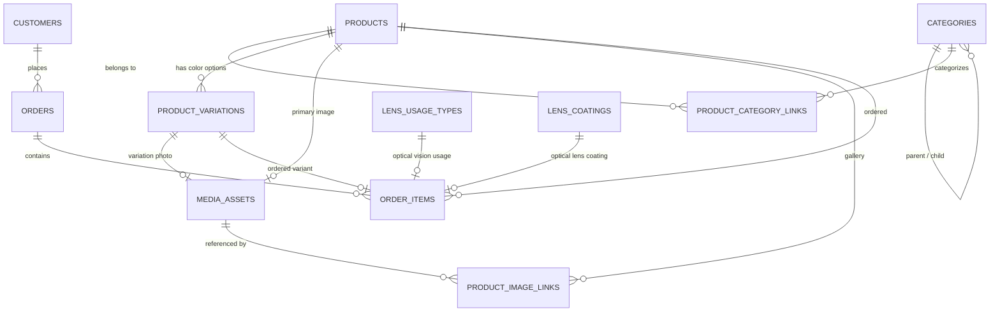

# Rida Optical — Neon PostgreSQL Database Architecture (Phase 10)

> **Target Database Engine:** Neon Serverless PostgreSQL  
> **ORM Framework:** SQLModel (SQLAlchemy 2.0 + Pydantic v2)  
> **Migration Engine:** Alembic 1.17  
> **Source Platform:** WordPress 7.0.8 / WooCommerce MySQL Dumps (Read-Only)  
> **Verification Status:** Verified via SQLModel tests and Alembic baseline migration `001_initial_neon_schema`

---

## 1. Relational Schema Architecture

The legacy WordPress database relied on an Entity-Attribute-Value (EAV) postmeta architecture (`wp_postmeta`, `wp_posts`, `wp_term_relationships`). The target architecture completely normalizes this data into a modern relational schema designed for high-concurrency read operations, instant filtering, and transactional integrity.



---

## 2. Entity Specifications & Data Dictionary

### A. Catalog & Taxonomy Tables

#### 1. `categories`
Hierarchical taxonomy table preserving original WordPress term IDs.
- `id` (INTEGER, PK): Original WordPress `term_id` (e.g. `133` for Eye Glasses, `132` for SunGlasses, `15` for AL Mahash).
- `name` (VARCHAR(150), NOT NULL, INDEXED): Category display name.
- `slug` (VARCHAR(150), NOT NULL, UNIQUE, INDEXED): URL slug.
- `description` (TEXT, NULLABLE): Category description.
- `parent_id` (INTEGER, FK -> `categories.id`, NULLABLE, INDEXED): Self-referential parent for nested taxonomy (e.g. `Coat` -> `AL Mahash`).
- `product_count` (INTEGER, DEFAULT 0): Cached active product count.
- `thumbnail_id` (INTEGER, NULLABLE): Attachment ID for category banner.
- `is_active` (BOOLEAN, DEFAULT TRUE): Soft toggle for category display.
- `created_at` & `updated_at` (TIMESTAMPTZ, NOT NULL).

#### 2. `products`
Core optical eyewear catalog.
- `id` (INTEGER, PK): Original WordPress post ID (e.g. `4634`).
- `title` (VARCHAR(255), NOT NULL, INDEXED): Product frame name.
- `slug` (VARCHAR(255), NOT NULL, UNIQUE, INDEXED): URL route slug.
- `sku` (VARCHAR(100), NOT NULL, UNIQUE, INDEXED): Inventory SKU (e.g. `RO-4634`).
- `base_price_pkr` (FLOAT, NOT NULL, INDEXED): Minimum starting frame price.
- `regular_price_pkr` (FLOAT, NULLABLE): Original frame MSRP before discount.
- `sale_price_pkr` (FLOAT, NULLABLE): Active promotional price.
- `stock_status` (VARCHAR(50), DEFAULT 'instock', INDEXED): `instock` or `outofstock`.
- `is_featured` (BOOLEAN, DEFAULT FALSE, INDEXED): Homepage featured flag.
- `total_sales` (INTEGER, DEFAULT 0): Bestseller counter.
- `short_description` (TEXT, DEFAULT ''): Brief card summary.
- `description` (TEXT, DEFAULT ''): Full markdown/HTML frame specifications.
- `has_prescription_support` (BOOLEAN, DEFAULT TRUE, INDEXED): Enables 4-step optical lens builder.
- `primary_image_id` (INTEGER, FK -> `media_assets.id`, NULLABLE).
- `meta_title`, `meta_description`, `canonical_url` (VARCHAR, NULLABLE): SEO metadata.
- `created_at` & `updated_at` (TIMESTAMPTZ, NOT NULL).

#### 3. `product_variations`
Color variant children for variable eyewear frames.
- `id` (INTEGER, PK): Original WordPress variation post ID (e.g. `4727`).
- `product_id` (INTEGER, FK -> `products.id`, NOT NULL, INDEXED).
- `title` (VARCHAR(255), NOT NULL): e.g. `Fashion Eye Glasses - Green`.
- `slug` (VARCHAR(255), NOT NULL): e.g. `fashion-eye-glasses`.
- `sku` (VARCHAR(100), NOT NULL, UNIQUE, INDEXED): e.g. `RO-4634-4727`.
- `color_name` (VARCHAR(100), NOT NULL, INDEXED): e.g. `Green`, `Gray`, `Silver`, `Golden`.
- `color_slug` (VARCHAR(100), NOT NULL).
- `color_hex` (VARCHAR(20), NULLABLE): Hex color swatch code (e.g. `#81d742`).
- `size` (VARCHAR(50), DEFAULT 'Standard').
- `price_pkr` (FLOAT, NOT NULL): Color-specific price.
- `regular_price_pkr` & `sale_price_pkr` (FLOAT, NULLABLE).
- `stock_status` (VARCHAR(50), DEFAULT 'instock').
- `image_id` (INTEGER, FK -> `media_assets.id`, NULLABLE): Specific photo of this frame color.
- `created_at` & `updated_at` (TIMESTAMPTZ, NOT NULL).

#### 4. `product_category_links`
Normalized many-to-many junction between products and categories.
- `product_id` (INTEGER, FK -> `products.id`, PK).
- `category_id` (INTEGER, FK -> `categories.id`, PK).
- `is_primary` (BOOLEAN, DEFAULT FALSE).

---

### B. Media & Asset Management Tables

#### 5. `media_assets`
Stores physical and CDN metadata for all 313 media attachments.
- `id` (INTEGER, PK): Original WordPress attachment ID (e.g. `4629`).
- `title` (VARCHAR(255)).
- `file_path` (VARCHAR(500), NOT NULL): Relative path in uploads (e.g. `2025/07/1000424554-scaled.jpg`).
- `original_url` (VARCHAR(500), NOT NULL).
- `imagekit_url` (VARCHAR(500), NULLABLE): Optimized ImageKit CDN URL.
- `alt_text` (VARCHAR(255), DEFAULT '').
- `mime_type` (VARCHAR(100), DEFAULT 'image/jpeg').
- `width`, `height`, `file_size_bytes` (INTEGER, NULLABLE).
- `created_at` & `updated_at` (TIMESTAMPTZ, NOT NULL).

#### 6. `product_image_links`
Multi-angle product gallery associations.
- `id` (INTEGER, PK AUTOINCREMENT).
- `product_id` (INTEGER, FK -> `products.id`, INDEXED).
- `media_asset_id` (INTEGER, FK -> `media_assets.id`, INDEXED).
- `is_primary` (BOOLEAN, DEFAULT FALSE).
- `display_order` (INTEGER, DEFAULT 0).

---

### C. Optical Engine Tables (WAPF Post ID 4620 Parity)

#### 7. `lens_usage_types`
Vision usage types.
- `id` (VARCHAR(50), PK): `single-vision`, `bifocal-round`, `bifocal-d`, `progressive`.
- `name` (VARCHAR(100), NOT NULL).
- `slug` (VARCHAR(100), NOT NULL, UNIQUE, INDEXED).
- `description` (TEXT, NULLABLE).
- `price_modifier_pkr` (FLOAT, DEFAULT 0.0).
- `is_default` (BOOLEAN, DEFAULT FALSE).
- `display_order` (INTEGER, DEFAULT 0).

#### 8. `lens_coatings`
15 certified lens treatments and coatings.
- `id` (VARCHAR(50), PK): `screen-standard`, `transition-premium`, `drive-digital`, etc.
- `name` (VARCHAR(150), NOT NULL).
- `slug` (VARCHAR(150), NOT NULL, UNIQUE, INDEXED).
- `category` (VARCHAR(50), NOT NULL, INDEXED): `clear`, `blue_cut`, `photochromic`, `driving`, `tinted`, `polycarbonate`.
- `price_pkr` (FLOAT, NOT NULL): Surcharge (+Rs. 1,300 to +Rs. 3,500).
- `description` (TEXT, NULLABLE).
- `display_order` (INTEGER, DEFAULT 0).
- `is_active` (BOOLEAN, DEFAULT TRUE).

---

### D. Orders & Customer Relationship Tables

#### 9. `customers`
Customer contact & shipping records.
- `id` (INTEGER, PK AUTOINCREMENT).
- `full_name` (VARCHAR(150), NOT NULL, INDEXED).
- `phone` (VARCHAR(50), NOT NULL, INDEXED): WhatsApp phone number.
- `alternate_phone` (VARCHAR(50), NULLABLE).
- `email` (VARCHAR(150), NULLABLE, INDEXED).
- `address` (VARCHAR(500), NOT NULL): Street address & house number.
- `city` (VARCHAR(100), NOT NULL, INDEXED): e.g. Karachi, Lahore, Islamabad.
- `postal_code` (VARCHAR(20), NULLABLE).
- `created_at` & `updated_at` (TIMESTAMPTZ, NOT NULL).

#### 10. `orders`
Master transaction and checkout records.
- `id` (INTEGER, PK AUTOINCREMENT).
- `order_number` (VARCHAR(50), NOT NULL, UNIQUE, INDEXED): e.g. `RO-54321`.
- `customer_id` (INTEGER, FK -> `customers.id`, NOT NULL, INDEXED).
- `status` (VARCHAR(50), DEFAULT 'pending', INDEXED): `pending`, `processing`, `dispatched`, `completed`, `cancelled`.
- `payment_method` (VARCHAR(50), DEFAULT 'cod'): `cod`, `whatsapp`, `card`.
- `payment_status` (VARCHAR(50), DEFAULT 'unpaid'): `unpaid`, `paid`, `refunded`.
- `subtotal_pkr` (FLOAT, NOT NULL).
- `shipping_fee_pkr` (FLOAT, DEFAULT 349.0).
- `discount_pkr` (FLOAT, DEFAULT 0.0).
- `total_amount_pkr` (FLOAT, NOT NULL).
- `shipping_address` (VARCHAR(500), NOT NULL).
- `shipping_city` (VARCHAR(100), NOT NULL).
- `order_notes` (TEXT, NULLABLE).
- `tracking_number` (VARCHAR(100), NULLABLE).
- `courier_name` (VARCHAR(100), NULLABLE): e.g. `TCS`, `Leopards Courier`.
- `created_at` & `updated_at` (TIMESTAMPTZ, NOT NULL).

#### 11. `order_items`
Line items with full optical prescription breakdown.
- `id` (INTEGER, PK AUTOINCREMENT).
- `order_id` (INTEGER, FK -> `orders.id`, NOT NULL, INDEXED).
- `product_id` (INTEGER, FK -> `products.id`, NOT NULL, INDEXED).
- `variation_id` (INTEGER, FK -> `product_variations.id`, NULLABLE).
- `product_title` (VARCHAR(255), NOT NULL).
- `variation_title` (VARCHAR(100), NULLABLE).
- `unit_frame_price` (FLOAT, NOT NULL).
- `quantity` (INTEGER, NOT NULL, DEFAULT 1).
- `line_total` (FLOAT, NOT NULL).
- `has_prescription` (BOOLEAN, DEFAULT FALSE).
- `lens_usage_id` (VARCHAR(50), FK -> `lens_usage_types.id`, NULLABLE).
- `lens_coating_id` (VARCHAR(50), FK -> `lens_coatings.id`, NULLABLE).
- `optical_surcharge` (FLOAT, DEFAULT 0.0).
- `prescription_text` (TEXT, NULLABLE).
- `prescription_file_url` (VARCHAR(500), NULLABLE).
- `pd_measurement` (VARCHAR(20), NULLABLE).
- `sph_od`, `cyl_od`, `axis_od`, `sph_os`, `cyl_os`, `axis_os` (VARCHAR(20), NULLABLE).

---

## 3. Database Connection & Neon Serverless Pooling

Configured in [`backend/app/core/database.py`](file:///E:/rida%20opt/Rida-Optical-Migration/backend/app/core/database.py):

```python
# Neon Serverless PostgreSQL connection pooling optimization
engine_kwargs["pool_pre_ping"] = True
engine_kwargs["pool_recycle"] = 300
engine_kwargs["pool_size"] = 5
engine_kwargs["max_overflow"] = 10
```

- **`pool_pre_ping = True`:** Prevents stale connection drops caused by Neon compute autoscaling/sleep.
- **`pool_recycle = 300`:** Recycles connections every 5 minutes to avoid idle socket timeouts.
- **`postgresql+psycopg`:** Uses the modern Psycopg 3 binary driver for performance.

---

## 4. Alembic Migration Lifecycle

Alembic environment initialized inside [`backend/alembic/`](file:///E:/rida%20opt/Rida-Optical-Migration/backend/alembic/):

- Baseline revision: [`001_initial_neon_schema.py`](file:///E:/rida%20opt/Rida-Optical-Migration/backend/alembic/versions/20261119_001_initial_neon_schema.py)
- Command to apply migrations to any connected PostgreSQL / SQLite instance:
  ```bash
  cd backend
  alembic upgrade head
  ```
- Command to generate subsequent migrations:
  ```bash
  cd backend
  alembic revision --autogenerate -m "description_of_changes"
  ```
