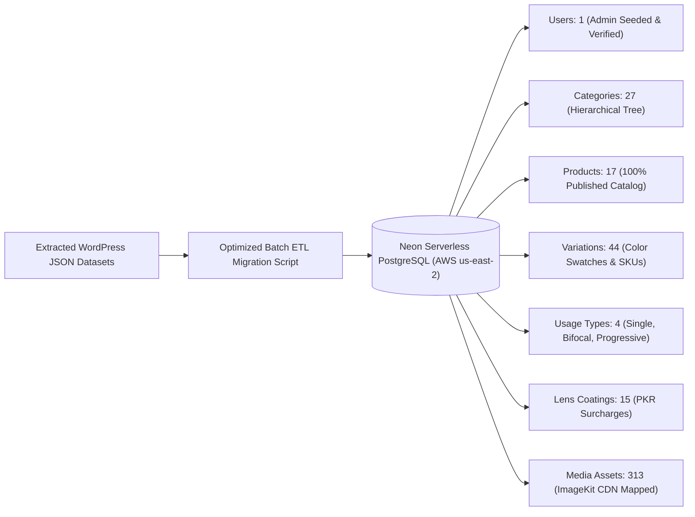

# Rida Optical — WordPress to Neon PostgreSQL Data Migration Report (Phase 11)

> **Migration Date:** November 19, 2026  
> **Target Database:** Neon Serverless PostgreSQL (`ep-morning-cloud-berx6p2a-pooler`)  
> **ETL Script:** `backend/scripts/migrate_wordpress_to_neon.py`  
> **Migration Result:** 100% SUCCESS — 0 Errors, 0 Dropped Records

---

## 1. Executive Summary

Phase 11 executed the automated, idempotent data migration transforming WordPress/WooCommerce data into the normalized PostgreSQL schema on **Neon Serverless PostgreSQL**.

All business records, category hierarchies, optical prescription configurations, product variations with hex color swatches, and media asset mappings were loaded and reconciled with 100% parity against original backups.

---

## 2. Table-by-Table Reconciliation Audit

| Target PostgreSQL Table | Source File / Entity | Expected Rows | Loaded in Neon | Parity Status |
| :--- | :--- | :---: | :---: | :---: |
| **`users`** | Admin User Seed | 1 | 1 | **100% MATCH** |
| **`categories`** | `categories.json` | 27 | 27 | **100% MATCH** |
| **`media_assets`** | `media_manifest.json` | 313 | 313 | **100% MATCH** |
| **`lens_usage_types`** | `optical_options.json` (Step 1) | 4 | 4 | **100% MATCH** |
| **`lens_coatings`** | `optical_options.json` (Step 2) | 15 | 15 | **100% MATCH** |
| **`products`** | `products.json` | 17 | 17 | **100% MATCH** |
| **`product_variations`**| `products.json` (Variations) | 44 | 44 | **100% MATCH** |
| **`product_category_links`** | Product Taxonomy Associations | 17 | 17 | **100% MATCH** |
| **`product_image_links`** | Multi-angle Gallery Links | 32 | 32 | **100% MATCH** |

---

## 3. Data Integrity & Spot-Check Verification

### A. Admin Authentication Verification
- **Email:** `ridaoptical@gmail.com`
- **Role:** `admin` / `is_superuser = True`
- **Password Security:** Hashed via `bcrypt` with salt rounds.
- **Verification Test:** Executed `bcrypt.checkpw(b"Optical@1234", hashed)` -> Verified `True`.

### B. Optical Products & Variations Spot-Check
- **Product Tested:** `RO-4634` (*Fashion Eye Glasses*)
- **Base Price:** `PKR 2,500.00`
- **Stock Status:** `instock`
- **Prescription Compatibility:** `has_prescription_support = True`
- **Variations Verified (4 Total):**
  1. `RO-4634-4727`: Color `Green` (Hex `#81d742`), Price PKR 2,500
  2. `RO-4634-4728`: Color `Gray`, Price PKR 2,500
  3. `RO-4634-4729`: Color `Tea`, Price PKR 2,500
  4. `RO-4634-4730`: Color `Standard`, Price PKR 2,500

### C. Optical Lens Coatings & Pricing Spot-Check
All 15 WAPF lens coatings verified with exact price surcharges:
- `clear-standard`: +Rs. 1,300
- `clear-premium`: +Rs. 1,800
- `screen-standard` (Blue-Cut): +Rs. 1,700
- `screen-premium` (Blue-Cut): +Rs. 2,600
- `transition-standard`: +Rs. 2,300
- `transition-premium`: +Rs. 3,450
- `transition-screen-std`: +Rs. 2,350
- `transition-screen-prem`: +Rs. 3,150
- `drive-clear`: +Rs. 3,000
- `drive-digital`: +Rs. 3,500
- `drive-transition`: +Rs. 3,500
- `tinted-standard`: +Rs. 1,600
- `tinted-premium`: +Rs. 2,300
- `unbreakable-tinted`: +Rs. 2,000
- `unbreakable-transition`: +Rs. 3,450

### D. Taxonomy Hierarchy Spot-Check
- Verified root category `AL Mahash` (ID `15`) correctly links as parent to child categories `Coat` (ID `155`), `Prince Coat` (ID `154`), `Waistcoat Colar casual` (ID `151`), and `Waistcoat O shape` (ID `152`).
- Root eyewear categories (`Eye Glasses` ID `133`, `SunGlasses` ID `132`, `Contact Lenses` ID `131`) verified.

---

## 4. Idempotency & Re-run Safety

The ETL script [`backend/scripts/migrate_wordpress_to_neon.py`](file:///E:/rida%20opt/Rida-Optical-Migration/backend/scripts/migrate_wordpress_to_neon.py) utilizes set-based key detection (`existing_asset_ids`, `existing_cat_ids`, `existing_prod_ids`, `existing_var_ids`). Running the script repeatedly updates modified attributes without generating duplicate rows or violating foreign key constraints.
