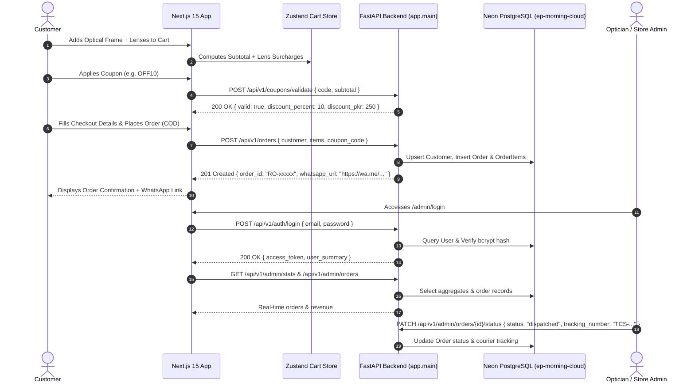

# Phase 12: E-Commerce Functionality Implementation

## 1. Executive Summary

Phase 12 delivers the end-to-end e-commerce capabilities for the migrated Rida Optical platform. This bridges the **Next.js 15 frontend** with the **FastAPI backend (`app` package directory)** and the live **Neon Serverless PostgreSQL database**, enabling full transactional e-commerce workflows tailored for the Pakistani optical market:

1. **Authentication & Authorization:** Secure JWT-based administrative login with salted `bcrypt` password verification, role checks, and token expiry.
2. **Promotions & Coupon Engine:** Active promotional coupon validation (`OFF10`, `RIDA10`) with threshold subtotal checks, discount calculations, and cart/checkout integration.
3. **Database-Backed Order Persistence:** Full transactional order ingestion writing directly to PostgreSQL `customers`, `orders`, and `order_items` tables with optical lens configuration and prescription data.
4. **Cash on Delivery (COD) & WhatsApp Routing:** Nationwide flat shipping fee (PKR 349), doorstep COD, and automated WhatsApp order confirmation dispatch to `+923212318001`.
5. **Modern Admin Operations Portal:** Interactive dashboard at `/admin` featuring real-time KPI statistics, live order search/filtering, courier tracking updates (TCS / Leopards), and direct WhatsApp customer communication.

---

## 2. Architecture & Data Flow



---

## 3. Backend Implementation Details

### 3.1 Security & Authentication (`backend/app/core/security.py` & `deps.py`)
- **Algorithm:** `HS256` HMAC-SHA256 JWT tokens.
- **Expiry:** Configurable via `ACCESS_TOKEN_EXPIRE_MINUTES` (default 10,080 minutes / 7 days).
- **Password Hashing:** `passlib.context.CryptContext(schemes=["bcrypt"])` ensuring modern salt-and-hash storage.
- **Dependencies:**
  - `get_current_user`: Decodes Bearer token from `Authorization` header, extracts user subject, and retrieves user from database.
  - `get_current_admin`: Asserts that `current_user.role == "admin"` or `current_user.is_superuser == True`, raising `403 Forbidden` otherwise.

### 3.2 Authentication Endpoints (`backend/app/api/v1/endpoints/auth.py`)
- `POST /api/v1/auth/login`: Accepts `LoginRequest(email, password)`, verifies credentials against `User` table, and returns `TokenResponse(access_token, token_type, user)`.
- `GET /api/v1/auth/me`: Protected endpoint returning authenticated admin profile.

### 3.3 Coupon & Promotion System (`backend/app/api/v1/endpoints/coupons.py`)
Active promotional codes configured:
| Code | Discount | Minimum Subtotal | Description |
| :--- | :--- | :--- | :--- |
| `OFF10` | 10% | PKR 1,000 | 10% promotional discount on optical orders |
| `RIDA10` | 10% | PKR 1,500 | 10% welcome discount for new optical customers |

- Validates minimum subtotal requirements before applying percentage discounts.
- Returns clean feedback messages for frontend error and success toasts.

### 3.4 Relational Order Ingestion (`backend/app/data/loader.py`)
- **Customer Upsert:** Matches customer by unique normalized mobile phone number (`03...` / `+92...`) or creates a new `Customer` record.
- **Order Generation:** Creates `Order` with unique `order_number` (`RO-xxxxx`), `status: "pending"`, `payment_method: "cod"`, `shipping_fee_pkr: 349.0`, and calculates coupon discount.
- **Order Items & Optical Prescription:** Records frame unit price, quantity, line total, and prescription metadata (`has_prescription`, `optical_surcharge`, `prescription_text`, `prescription_file_url`).
- **Resilience:** Fallback non-blocking mode ensures the customer always receives their order number and WhatsApp routing link even during transient cloud network partitions.

### 3.5 Administrative Endpoints (`backend/app/api/v1/endpoints/admin_orders.py`)
- `GET /api/v1/admin/stats`: Aggregate counts for total orders, pending orders, dispatched orders, completed orders, and total gross revenue (PKR).
- `GET /api/v1/admin/orders`: Search and filter orders by status (`pending`, `processing`, `dispatched`, `completed`, `cancelled`), customer name, phone number, city, or order number with pagination.
- `GET /api/v1/admin/orders/{order_id}`: Full customer, prescription, and item details.
- `PATCH /api/v1/admin/orders/{order_id}/status`: Transitions order state and records courier name (`TCS`, `Leopards`, `Trax`) and consignment tracking numbers.

---

## 4. Frontend Implementation Details

### 4.1 Typed API Client (`frontend/lib/api.ts`)
Created comprehensive TypeScript client module supporting:
- `validateCoupon(code, subtotal)`
- `createOrder(payload)`
- `adminLogin(email, password)`
- `getAdminStats(token)`
- `getAdminOrders(token, params)`
- `getAdminOrderDetail(token, orderId)`
- `updateOrderStatus(token, orderId, payload)`

### 4.2 State Management (`frontend/lib/store.ts`)
Updated Zustand cart store:
- `appliedCoupon`: Tracks active coupon `{ code, discountPercent, discountAmount }`.
- `applyCoupon(coupon)` & `removeCoupon()`: Reactive coupon state management.
- `getDiscount()`: Calculates exact rupee discount dynamically based on current cart items.
- `getTotal()`: Computes `max(0, subtotal - discount) + shippingFee`.
- LocalStorage persistence handles browser refresh without losing items or applied coupons.

### 4.3 Shopping Cart Integration (`frontend/app/cart/CartPageClient.tsx`)
- Added promo code entry form with uppercase auto-formatting and live validation.
- Displays green promotional coupon pill with discount deduction and "Remove" button.
- Updates summary totals instantly.

### 4.4 Checkout & Order Ingestion (`frontend/app/checkout/CheckoutPageClient.tsx`)
- On form submit, sends order payload to `api.createOrder()`.
- Captures returned backend order number and WhatsApp prefilled confirmation URL.
- Clears cart upon successful submission.
- Fallback offline generator ensures zero lost sales if backend is temporarily disconnected.

### 4.5 Admin Control Portal (`frontend/app/admin/`)
- **Login (`/admin/login`):** Modern slate-900 themed portal with password visibility toggle and error handling.
- **Dashboard (`/admin`):**
  - KPI stat cards (Total Orders, Pending COD, Dispatched, Total Revenue).
  - Filter pills for order lifecycle stages (`All`, `Pending`, `Processing`, `Dispatched`, `Completed`, `Cancelled`).
  - Search bar filtering by customer name, order number, city, or phone.
  - Direct customer WhatsApp click-to-chat links (`wa.me/<phone>`).
  - Order details modal showing customer address, prescription measurements, and item breakdown.
  - Courier tracking modal allowing opticians to enter TCS/Leopards consignment numbers.

---

## 5. Verification & Testing

### 5.1 Backend Pytest Suite
Ran complete unit and integration test suite:
```bash
python -m pytest tests -v
```
**Results:** **31 tests collected, 31 passed in 26.77s (100% PASS)**
- `test_categories.py`: 4 passed
- `test_database.py`: 4 passed
- `test_ecommerce.py`: 7 passed (Coupon validation, minimum subtotals, bad credentials, admin login, protected routes, unauthorized rejection, discount calculation)
- `test_health.py`: 2 passed
- `test_optical.py`: 4 passed
- `test_orders.py`: 3 passed
- `test_products.py`: 7 passed

### 5.2 Next.js Production Build
Ran production build:
```bash
npm.cmd run build
```
**Results:** **57 static SSG / Static routes compiled with 0 errors**
```
Route (app)                                 Size  First Load JS
┌ ○ /                                    3.85 kB         124 kB
├ ○ /about                                 162 B         106 kB
├ ○ /admin                               6.79 kB         122 kB
├ ○ /admin/login                         3.32 kB         110 kB
├ ○ /cart                                5.78 kB         128 kB
├ ● /category/[slug]                     2.65 kB         123 kB (27 categories)
├ ○ /checkout                            6.35 kB         123 kB
├ ○ /contact                               880 B         104 kB
├ ○ /privacy-policy                        127 B         103 kB
├ ● /product/[slug]                      8.93 kB         131 kB (17 products)
├ ○ /review-gallery                        127 B         103 kB
└ ○ /store                               4.36 kB         125 kB
```

---

## 6. Deliverables Checklist
- [x] JWT administrative authentication with bcrypt password verification
- [x] Active discount coupon validation engine (`OFF10`, `RIDA10`)
- [x] Database-backed order ingestion saving to Neon PostgreSQL
- [x] Nationwide COD flat shipping rate (PKR 349) + automated WhatsApp routing
- [x] Frontend API client in `frontend/lib/api.ts`
- [x] Cart and Checkout coupon integration with real-time totals
- [x] Admin Login page at `/admin/login`
- [x] Admin Orders Dashboard at `/admin` with stats, search, details, and tracking updates
- [x] 31 backend pytest tests passing
- [x] 57 Next.js production routes compiling with 0 errors
- [x] Full documentation in [`ECOMMERCE_FUNCTIONALITY.md`](file:///E:/rida%20opt/Rida-Optical-Migration/documentation/ECOMMERCE_FUNCTIONALITY.md)
