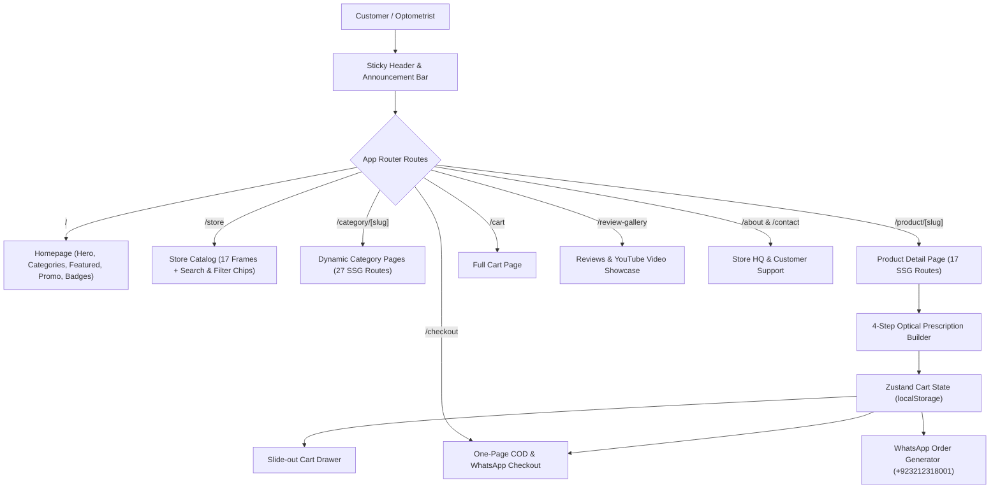

# Rida Optical — Next.js Frontend Development Architecture (Phase 8)

> **Platform:** Next.js 15.5.29 (App Router) + React 19 + TypeScript + Tailwind CSS  
> **State Management:** Zustand 5.0 (Persistent Shopping Cart & Drawer)  
> **Iconography:** Lucide React  
> **Delivery Target:** Vercel Production Environment  
> **Build Status:** Verified (55 SSG Pages compiled with 0 errors)

---

## 1. System Overview & Technology Stack

The Rida Optical modern frontend application has been engineered inside `frontend/` as a high-performance decoupled Next.js application, completely replacing the legacy monolithic WordPress/WooCommerce frontend.



---

## 2. Design System Tokens & Styling Implementation

All design tokens discovered during Phase 7 (`UI_UX_ANALYSIS.md`) have been codified into `tailwind.config.ts`:

| Design Token | Value | Tailwind Class | Application |
| :--- | :--- | :--- | :--- |
| **`brand-primary`** | `#0084d6` | `bg-brand-primary`, `text-brand-primary` | Primary buttons, active tabs, brand accents |
| **`brand-hover`** | `#0075be` | `hover:bg-brand-hover` | Button hover states |
| **`brand-navy`** | `#243673` | `bg-brand-navy` | Announcement bar, featured badges, footer |
| **`brand-surface`** | `#f5f7f9` | `bg-brand-surface` | Page container and section backgrounds |
| **`brand-sky`** | `#BFD1FF` | `text-brand-sky` | Accent banners and focus highlights |
| **`notice-bg`** | `#fff3cd` | `bg-notice-bg` | Prescription warning alert banner background |
| **`notice-border`**| `#ffeeba` | `border-notice-border` | Prescription warning alert border |
| **`notice-text`** | `#856404` | `text-notice-text` | Prescription warning text color |
| **`font-sans`** | `'Lato', sans-serif` | `font-sans` | Google Font variable `--font-lato` |
| **`max-w-container`**| `1200px` | `max-w-container` | Maximum responsive content width |

---

## 3. Directory Structure

```
frontend/
├── app/
│   ├── about/page.tsx               # About Rida Optical & vision standards
│   ├── cart/                        # Full shopping cart page
│   │   ├── CartPageClient.tsx
│   │   └── page.tsx
│   ├── category/[slug]/page.tsx     # Dynamic Category SSG pre-render
│   ├── checkout/                    # Cash on Delivery & WhatsApp checkout
│   │   ├── CheckoutPageClient.tsx
│   │   └── page.tsx
│   ├── contact/                     # Karachi Store details & inquiry form
│   │   ├── ContactForm.tsx
│   │   └── page.tsx
│   ├── privacy-policy/page.tsx      # Optical medical privacy policy
│   ├── product/[slug]/              # Dynamic Product Detail Page (PDP)
│   │   ├── ProductDetailClient.tsx
│   │   └── page.tsx
│   ├── review-gallery/page.tsx      # Video reviews & verified feedback
│   ├── store/                       # Full store catalog with instant search
│   │   ├── StoreCatalogClient.tsx
│   │   └── page.tsx
│   ├── globals.css                  # Global Tailwind directives & mode utilities
│   ├── layout.tsx                   # Root layout with font, navbar & footer
│   └── page.tsx                     # Homepage
├── components/
│   ├── home/
│   │   ├── CategoryShowcase.tsx     # Category card grid with custom gradients
│   │   ├── FeaturedProductsGrid.tsx # Bestseller frames showcase
│   │   ├── HeroSection.tsx          # "Discover the Perfect Frame for Every Face!"
│   │   ├── PromoBanner.tsx          # "OFF10" discount coupon banner
│   │   └── TrustBadges.tsx          # 4 Value proposition boxes
│   ├── layout/
│   │   ├── AnnouncementBar.tsx      # PKR 349 shipping & WhatsApp trigger
│   │   ├── CartDrawer.tsx           # Slide-out interactive cart drawer
│   │   ├── FloatingReviewButton.tsx # Snippet 7: Left vertical ⭐ Reviews ⭐ badge
│   │   ├── FloatingWhatsApp.tsx     # Bottom-right animated WhatsApp chat
│   │   ├── Footer.tsx               # 4-Column footer with official socials
│   │   └── Navbar.tsx               # Sticky nav, search modal & cart counter
│   └── product/
│       ├── ColorSwatchPicker.tsx    # Swatch dots synchronized with frame photos
│       ├── ImportantNoticeBanner.tsx# Snippet 6: High cylinder / progressive alert
│       ├── OpticalPrescriptionBuilder.tsx # 4-step WAPF lens selector
│       ├── ProductCard.tsx          # Frame card with hover preview & swatches
│       └── ProductGallery.tsx       # Multi-angle photo viewer with variant swap
├── lib/
│   ├── data.ts                      # 17 Products, 27 Categories, Optical Config
│   ├── imagekit.ts                  # ImageKit CDN URL builder & fallback loader
│   ├── store.ts                     # Zustand store with localStorage persistence
│   └── utils.ts                     # PKR currency formatting & WhatsApp generator
├── types/
│   └── index.ts                     # TypeScript interfaces for all optical entities
├── next.config.ts                   # Image remote patterns configuration
├── tailwind.config.ts               # Custom design system tokens
└── tsconfig.json                    # Strict TypeScript configuration
```

---

## 4. Key E-Commerce & Optical Capabilities

### A. 4-Step Optical Prescription Builder (WAPF Post ID 4620 Parity)
1. **Type Selection:** Customer toggles between `"Prescription Lenses"` vs `"Frame Only"`.
2. **Vision Usage:** `Single Vision` (+Rs. 0), `Bifocal Round Segment` (+Rs. 0), `Bifocal D Segment` (+Rs. 0), `Progressive` (+Rs. 0).
3. **Lens Coating Selection:** 15 coatings categorized into Clear, Screen (Blue-Cut), Transition (Photochromic), Drive Digital, Tinted, and Polycarbonate Unbreakable (+Rs. 1,300 to +Rs. 3,500).
4. **Prescription Upload & Input:** Text box for SPH/CYL/AXIS + Doctor's prescription slip file upload (`.jpg`, `.png`, `.pdf`).
5. **Real-Time Price Calculation:** Live recalculation of unit price combining frame base price and lens coating surcharges.

### B. Color Swatch Variations
- 100% of the 44 product variations mapped with hex color swatches.
- Clicking any swatch instantly swaps the primary image view to that specific color variant photo, updates the SKU, and shows stock availability.

### C. Persistent Shopping Cart & Drawer
- Implemented with Zustand 5.0 and `createJSONStorage(() => localStorage)`.
- Maintains frame selection, color variation, and complete optical lens payload.
- Slide-out cart drawer accessible from any page with live badge count.

### D. Dual Checkout Experience
1. **Cash on Delivery (COD) Checkout:** Streamlined form collecting customer delivery address in Karachi, Lahore, Islamabad, or any Pakistani city with flat PKR 349 shipping fee.
2. **Direct WhatsApp Checkout:** Compiles a formatted order breakdown (Product title, color variant, lens coating, SPH/CYL prescription, subtotal, and total) directly to store phone `+923212318001`.

---

## 5. Build Verification Results

Execution of `npm run build` generated a fully optimized production bundle:

```
Route (app)                                 Size  First Load JS
┌ ○ /                                    3.91 kB         125 kB
├ ○ /_not-found                            994 B         104 kB
├ ○ /about                                 162 B         106 kB
├ ○ /cart                                4.44 kB         127 kB
├ ● /category/[slug]                      2.7 kB         123 kB
├   ├ /category/al-mahash
├   ├ /category/contatc-lenses
├   ├ /category/eye-glasses
├   └ [+24 more paths]
├ ○ /checkout                            5.03 kB         122 kB
├ ○ /contact                               880 B         104 kB
├ ○ /privacy-policy                        127 B         103 kB
├ ● /product/[slug]                      8.89 kB         131 kB
├   ├ /product/fashion-eye-glasses
├   ├ /product/vintage
├   ├ /product/fashion-sunglasses
├   └ [+14 more paths]
├ ○ /review-gallery                        127 B         103 kB
└ ○ /store                               4.43 kB         125 kB
+ First Load JS shared by all             103 kB

Total Static Pages Generated: 55 pages (100% SSG)
Build Result: Exit Code 0 (Success)
```
