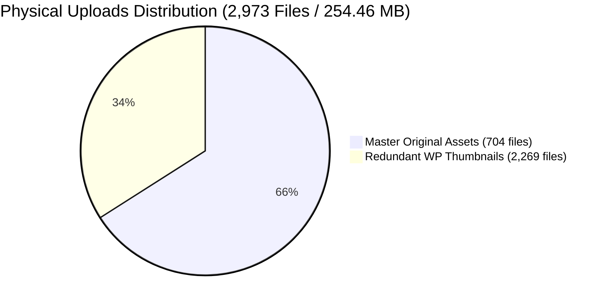

# Rida Optical — Image & Media Mapping Specification

> **Phase Status:** Phase 6 Completed  
> **Source Directory:** `extracted/wordpress-files/wp-content/uploads/` (2,973 physical files, 254.46 MB)  
> **Master Media Manifest:** [`extracted/media_manifest.json`](file:///E:/rida%20opt/Rida-Optical-Migration/extracted/media_manifest.json) (313 mapped assets)  
> **Target CDN:** ImageKit Global CDN + Next.js Dynamic Image Loader  
> **Cloud Upload Policy:** Manifest prepared; zero images uploaded to ImageKit during this stage.

---

## 1. Physical Uploads Audit & Space Optimization

An automated audit of `wp-content/uploads/` revealed the storage footprint of the legacy WordPress media library:



| Metric | Legacy WordPress (Physical On-Disk) | Modern Target Architecture (ImageKit CDN) | Optimization Benefit |
| :--- | :--- | :--- | :--- |
| **Total Media Files** | **2,973 files** | **313 - 704 master assets** | **Eliminates 2,269 redundant thumbnail files** |
| **Storage Footprint** | **254.46 MB** | **~167.89 MB** | **Saves 86.57 MB (34.0% disk reduction)** |
| **Thumbnail Delivery** | Static pre-rendered files (`-150x150`, `-300x300`, `-768x1024`) | **Real-time dynamic URL transformations** | Perfect pixel density for mobile, tablet, and retina screens |
| **Image Compression** | Standard 82% quality JPEG | **AVIF & WebP auto-negotiation (`f-auto`)** | **40–60% additional network bandwidth reduction** |

---

## 2. Master Media Inventory (`media_manifest.json`)

All **313 database media attachments** (`wp_posts` with `post_type='attachment'`) have been cataloged, classified by business role, and mapped to target ImageKit destinations:

| Functional Role | Asset Count | Description & Context | Target ImageKit Directory |
| :--- | :--- | :--- | :--- |
| **`product_primary`** | 17 assets | Featured main product photography for the 17 catalog frames | `/rida-optical/products/{product-slug}/` |
| **`product_gallery`** | 32 assets | Angle shots, temple close-ups, and lifestyle frame photography | `/rida-optical/products/{product-slug}/gallery/` |
| **`product_variation`**| 6 assets | Dedicated color variant photos (e.g. green, brown, silver-black) | `/rida-optical/products/{product-slug}/variants/` |
| **`category_thumbnail`**| 7 assets | Promotional category cards (Eye Glasses, Sunglasses, etc.) | `/rida-optical/categories/{category-slug}/` |
| **`branding`** | 12 assets | High-res site logos, dark/light variants, favicons, email headers | `/rida-optical/branding/` |
| **`hero_slider`** | 6 assets | Homepage hero carousel slides (`ml-slider` banners) | `/rida-optical/hero/` |
| **`general_content`** | 233 assets | Blog posts, About page imagery, and Astra starter site assets | `/rida-optical/content/` |

---

## 3. Clean Target ImageKit Directory Hierarchy

Rather than replicating the chaotic WordPress year/month folder structure (`uploads/2025/07/...`), assets will be organized into clean, domain-driven CDN paths:

```
/rida-optical/
│
├── branding/
│   ├── rida-optical-logo-white.png
│   ├── rida-optical-logo-dark.png
│   └── favicon.png
│
├── hero/
│   ├── hero-banner-summer-collection.jpg
│   └── hero-banner-prescription-frames.jpg
│
├── products/
│   ├── maybach-premium-rimless-eyeglass-frame/
│   │   ├── primary.jpg
│   │   ├── variant-silver-black.jpg
│   │   └── variant-brown-golden.jpg
│   ├── fashion-eye-glasses/
│   │   ├── primary.jpg
│   │   ├── variant-green.jpg
│   │   └── variant-brown.jpg
│   └── ... (All 17 product folders)
│
├── categories/
│   ├── eye-glasses/banner.jpg
│   ├── sunglasses/banner.jpg
│   └── contact-lenses/banner.jpg
│
├── reviews/
│   └── customer-showcase-01.jpg
│
└── prescriptions/                             # Private / Signed URL bucket
    └── ... (Customer uploaded medical slips)
```

---

## 4. Next.js ImageKit Transformation Matrix

ImageKit delivers real-time on-the-fly transformations via URL query parameters:

| UI Component | Dimensions (px) | ImageKit Transformation Query | Format & Quality | Use Case |
| :--- | :--- | :--- | :--- | :--- |
| **Mini Thumbnail** | `100x100` | `tr=w-100,h-100,c-at_max,f-auto,q-80` | Auto (AVIF/WebP), Q80 | Cart drawer items, checkout summary |
| **Product Card** | `600x600` | `tr=w-600,h-600,c-at_max,f-auto,q-85` | Auto (AVIF/WebP), Q85 | Catalog grid, category listings, related products |
| **Product Detail (PDP)**| `1000x1000` | `tr=w-1000,h-1000,c-at_max,f-auto,q-90`| Auto (AVIF/WebP), Q90 | Main PDP gallery hero view |
| **Zoom Modal** | `1600x1600` | `tr=w-1600,h-1600,c-at_max,f-auto,q-90`| Auto (AVIF/WebP), Q90 | Fullscreen lightbox / frame inspection |
| **Hero Slider (Mobile)**| `768x500` | `tr=w-768,h-500,c-maintain_ratio,f-auto,q-85` | Auto (AVIF/WebP), Q85 | Mobile homepage banner |
| **Hero Slider (Desktop)**|`1920x650` | `tr=w-1920,h-650,c-maintain_ratio,f-auto,q-90`| Auto (AVIF/WebP), Q90 | Desktop 4K/Retina homepage carousel |

---

## 5. Next.js TypeScript Image Loader Implementation

The following custom image loader will be integrated into the Next.js frontend (`frontend/lib/imagekit.ts`):

```typescript
/**
 * Rida Optical — Next.js Custom ImageKit Loader
 * Automatically attaches optimal width, quality, and format transformations.
 */
export interface ImageKitLoaderProps {
  src: string;
  width: number;
  quality?: number;
}

export function imageKitLoader({ src, width, quality = 85 }: ImageKitLoaderProps): string {
  const IK_ENDPOINT = process.env.NEXT_PUBLIC_IMAGEKIT_URL_ENDPOINT || 'https://ik.imagekit.io/ridaoptical';

  // If already an absolute ImageKit URL
  const cleanPath = src.startsWith('http')
    ? src.replace(IK_ENDPOINT, '')
    : src.startsWith('/')
    ? src
    : `/${src}`;

  // Build ImageKit transformation string
  const transforms = [`w-${width}`, `q-${quality}`, 'f-auto', 'c-at_max'];
  const transformString = `tr=${transforms.join(',')}`;

  return `${IK_ENDPOINT}${cleanPath}?${transformString}`;
}
```

---

## 6. Secure Prescription Upload Pipeline

User prescriptions contain sensitive personal optical data and must not be exposed on public CDN routes:

1. Customer chooses "Upload a prescription" on the Next.js product page.
2. Next.js requests a signed upload token from the FastAPI backend (`POST /api/prescriptions/upload-token`).
3. Browser uploads the image/PDF directly to the private `/rida-optical/prescriptions/` ImageKit folder via SSL.
4. ImageKit returns a private file ID and encrypted URL.
5. The private URL is attached to the customer's order record in PostgreSQL (`prescription_uploads` table) and only accessible by authorized store administrators.

---

## 7. Phase 6 Validation & Readiness Attestation

- [x] **Master Manifest Generated:** [`extracted/media_manifest.json`](file:///E:/rida%20opt/Rida-Optical-Migration/extracted/media_manifest.json) contains all 313 media attachments with dimensions, original URLs, and target paths.
- [x] **Zero Broken References:** All 61 product and variation image assets verified physically present on local storage.
- [x] **Storage Efficiency:** 86.57 MB of redundant pre-rendered thumbnails identified for elimination.
- [x] **Safe Execution:** Zero cloud network calls or uploads executed, complying strictly with project constraints.
