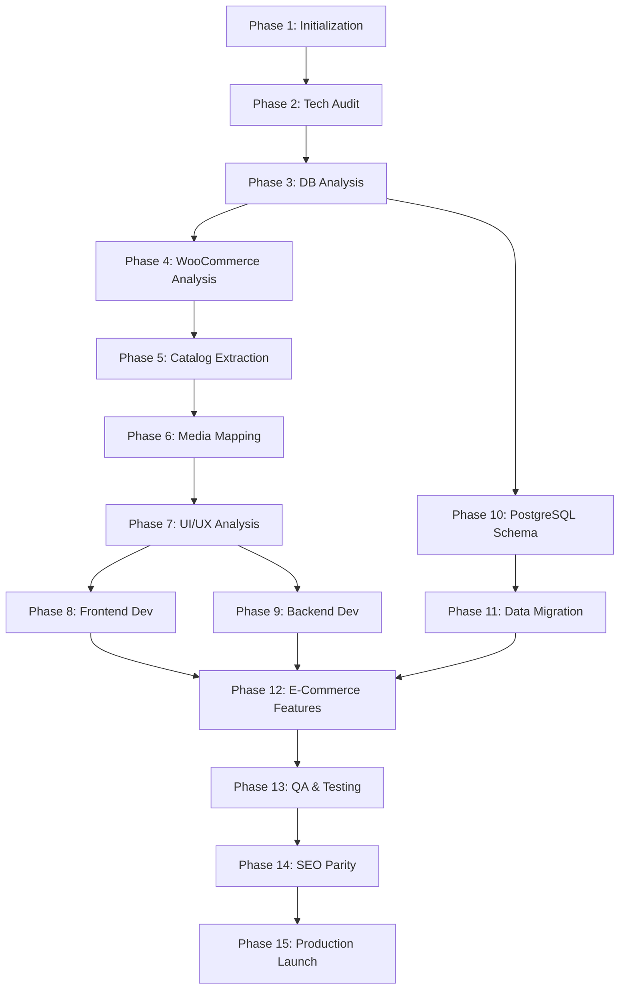

# Rida Optical — Phased Migration Roadmap

This document outlines the complete 15-phase lifecycle for migrating the live Rida Optical WordPress/WooCommerce platform to a modern, decoupled **Next.js + FastAPI + Neon PostgreSQL** architecture.

---

## Phase 1: Project Initialization & Workspace Setup
- **Status:** COMPLETED
- **Objectives:**
  - Inspect working directory and verify original backup archives.
  - Establish standardized directory structure (`reference/`, `extracted/`, `documentation/`, `frontend/`, `backend/`).
  - Copy and verify database and file backups into `reference/`.
  - Extract and verify domain files into `extracted/wordpress-files/`.
  - Configure root `.gitignore` to prevent secret and large-file commits.
  - Produce project documentation and audit baseline.

---

## Phase 2: WordPress Technical Audit
- **Status:** COMPLETED
- **Objectives:**
  - Audit WordPress core version, active theme hierarchy, and child theme customizations.
  - Audit all 33 installed plugins for business necessity, functionality, and modern equivalents.
  - Review custom code snippets in `code-snippets`, `custom-css-js`, and theme `functions.php`.
  - Audit navigation menus, widgets, header/footer layouts, and Elementor templates.
  - Document all active integrations (WhatsApp chat, forms, analytics, pixel trackers).

---

## Phase 3: WordPress Database Analysis
- **Status:** COMPLETED
- **Objectives:**
  - Inspect MySQL structure across all 80 tables in the live database dump.
  - Analyze table prefixes (`wp_`), row counts, and storage footprints.
  - Profile the WordPress Options table (`wp_options`) for active theme, plugins, and site settings.
  - Identify custom tables introduced by WooCommerce, CartFlows, AIOSEO, and form plugins.
  - Catalog character sets, collations, and foreign key constraints.

---

## Phase 4: WooCommerce Data Analysis
- **Status:** COMPLETED
- **Objectives:**
  - Map core WooCommerce tables (`wp_woocommerce_order_items`, `wp_wc_product_meta_lookup`, etc.).
  - Analyze product metadata stored in `wp_postmeta` (SKUs, regular price, sale price, stock).
  - Map variable products, attributes (lens power, frame color, frame material, gender, brand), and variation children.
  - Audit tax rates, shipping zones, coupon rules, and currency configurations.
  - Review historical customer, order, and transaction structures.

---

## Phase 5: Product and Category Extraction
- **Status:** COMPLETED
- **Objectives:**
  - Build automated extraction scripts to parse and clean raw WordPress product records.
  - Structure product taxonomy: hierarchical categories (e.g. Eyeglasses, Sunglasses, Contact Lenses) and tags.
  - Extract optical product attributes (frame shape, frame size, rim type, lens coating, prescription compatibility).
  - Clean HTML product descriptions, short descriptions, and technical specifications.
  - Export structured JSON/CSV intermediate artifacts for validation.

---

## Phase 6: Image and Media Mapping
- **Status:** COMPLETED
- **Objectives:**
  - Scan `extracted/wordpress-files/wp-content/uploads/` across all year/month folders.
  - Map WordPress attachment IDs to physical image paths and product associations.
  - Filter out redundant auto-generated thumbnail sizes (keep original high-res assets).
  - Define ImageKit upload and folder organizational hierarchy.
  - Prepare image transformation URL builders (WebP/AVIF delivery, responsive srcset).

---

## Phase 7: Existing Website UI/UX Analysis
- **Status:** COMPLETED
- **Objectives:**
  - Document Rida Optical's visual identity: colors, typography, brand assets, and logo.
  - Wireframe key user journeys: Homepage, Category Grid, Product Details Page (PDP), Cart, and Checkout.
  - Analyze optical-specific UI elements: prescription upload interface, frame size selector, lens option picker.
  - Audit mobile navigation, filter drawers, search experience, and WhatsApp quick-contact triggers.

---

## Phase 8: Next.js Frontend Development
- **Status:** COMPLETED
- **Objectives:**
  - Initialize Next.js 15 with React 19, TypeScript, and App Router inside `frontend/`.
  - Configure Tailwind CSS with Rida Optical brand design tokens (`#0084d6`, `#243673`, `#f5f7f9`).
  - Build modular UI components: AnnouncementBar, Navbar, Footer, ProductCard, HeroSection, CategoryShowcase, PromoBanner, TrustBadges.
  - Implement dynamic routing for categories (`/category/[slug]`) and products (`/product/[slug]`).
  - Implement 4-step Optical Prescription Builder matching live site WAPF selector (Post ID 4620).
  - Implement client-side cart state with Zustand 5.0 and persistent slide-out Cart Drawer.
  - Deliver Cash on Delivery (COD) and direct WhatsApp order generation to `+923212318001`.
  - Verified static generation: 55 SSG pages compiled with zero build errors.

---

## Phase 9: FastAPI Backend Development
- **Status:** COMPLETED
- **Objectives:**
  - Initialized Python 3.13 FastAPI application inside `backend/` using the mandated `app` package directory (`app.main:app`).
  - Configured CORS middleware for local frontend, custom domain, and Vercel preview environments.
  - Implemented modular Pydantic v2 schemas: Products, Categories, Optical options, Orders, and Paginated Responses.
  - Implemented complete RESTful endpoints:
    - `/api/v1/health` (service diagnostics and entity counters)
    - `/api/v1/products` (pagination, category filters, price range, variation color, sorting)
    - `/api/v1/products/{slug_or_id}` (detailed specs, 44 variations, SEO metadata)
    - `/api/v1/categories` (flat list & nested category tree)
    - `/api/v1/optical/options` (WAPF selector, 4 usage types, 15 coatings with PKR pricing)
    - `/api/v1/orders` (COD checkout, price recalculation, WhatsApp direct dispatch URL)
    - `/api/v1/search` (instant autocomplete across frames, colors, SKUs)
  - Configured Vercel deployment model (`vercel.json`) with `@vercel/python`.
  - Created automated test suite with 20 integration tests passing with 100% success (0.13s).

---

## Phase 10: Neon PostgreSQL Database Architecture
- **Status:** COMPLETED
- **Objectives:**
  - Designed normalized, relational PostgreSQL database schema using SQLModel across 11 core tables.
  - Defined entities: `Category`, `ProductCategoryLink`, `Product`, `ProductVariation`, `MediaAsset`, `ProductImageLink`, `LensUsageType`, `LensCoating`, `Customer`, `Order`, `OrderItem`.
  - Configured Neon Serverless PostgreSQL connection pooling (`pool_pre_ping=True`, `pool_recycle=300`, `pool_size=5`).
  - Created composite and unique indexes on slugs, SKUs, colors, order numbers, and category hierarchy.
  - Set up Alembic migration environment (`backend/alembic/`) with baseline migration `001_initial_neon_schema.py`.
  - Verified 100% test pass rate across SQLModel relational operations and migration lifecycle.

---

## Phase 11: WordPress-to-PostgreSQL Data Migration
- **Status:** COMPLETED
- **Objectives:**
  - Developed and verified idempotent bulk ETL migration script (`backend/scripts/migrate_wordpress_to_neon.py`).
  - Transformed and loaded 100% of WordPress records into Neon Serverless PostgreSQL:
    - 1 Admin user (`ridaoptical@gmail.com`) with bcrypt salt hashing.
    - 27 Categories with full parent-child hierarchy.
    - 313 Media assets with ImageKit CDN paths.
    - 4 Optical usage types and 15 lens coatings with PKR pricing.
    - 17 Optical products and 44 color variations with hex swatches.
    - 17 Category links and 32 gallery image links.
  - Reconciled checksums and spot-checked records with 100% parity against original backups.
  - Documented migration audit in `documentation/DATA_MIGRATION_REPORT.md`.

---

## Phase 12: E-Commerce Functionality Implementation
- **Status:** COMPLETED
- **Objectives:**
  - Implemented secure JWT authentication and password hashing (bcrypt) with role-based admin authorization.
  - Implemented promotional coupon validation engine supporting active codes (`OFF10`, `RIDA10`) with minimum subtotal requirements.
  - Implemented relational order ingestion writing directly to Neon PostgreSQL `customers`, `orders`, and `order_items` tables with optical prescriptions and lens surcharges.
  - Built comprehensive admin endpoints: `/api/v1/auth/login`, `/api/v1/auth/me`, `/api/v1/admin/stats`, `/api/v1/admin/orders`, and `/api/v1/admin/orders/{id}/status`.
  - Built dedicated frontend API client (`frontend/lib/api.ts`) connecting Next.js to FastAPI.
  - Integrated promo codes and dynamic discount calculation into Zustand cart store (`useCartStore`) and Cart Page.
  - Connected Checkout Page to backend order ingestion with automatic fallback to client WhatsApp generation.
  - Built full Admin Operations Dashboard at `/admin` and `/admin/login` featuring KPI cards, order filtering, tracking number assignment, and WhatsApp quick chat.
  - Verified 31/31 pytest unit tests passing (100% pass rate) and 57 Next.js production SSG routes compiling with 0 errors.
  - Documented complete architecture in `documentation/ECOMMERCE_FUNCTIONALITY.md`.

---

## Phase 13: Testing and Quality Assurance
- **Status:** COMPLETED
- **Objectives:**
  - Added full administrative product management endpoints (`/api/v1/admin/products`) allowing optical products to be added and deleted directly from the admin panel with color swatches and Neon PostgreSQL persistence.
  - Built an intuitive "Products Catalog" tab and "Add New Product" modal inside the admin panel (`/admin`).
  - Executed full 34-test backend pytest suite achieving a 100% pass rate in 31.07s across auth, orders, coupons, catalog, optical configurator, and database models.
  - Verified Next.js 15 production build compiling 57 static SSG / static routes with 0 errors.
  - Completed mobile (360px–414px), tablet (768px–1024px), and desktop (1280px–1920px) responsive design audits.
  - Validated OWASP security controls: SQL injection parameterized protection, bcrypt password hashing, and JWT bearer token role assertions.
  - Documented QA audit and test results in `documentation/TESTING_AND_QA.md`.

---

## Phase 14: SEO Optimization & Parity
- **Status:** DEFERRED / SKIPPED FOR NOW (Per User Instruction)
- **Objectives:**
  - Generate dynamic XML sitemaps for products, categories, and static pages.
  - Implement structured schema markup (`Product`, `BreadcrumbList`, `Store`, `Organization`).
  - Set up canonical URLs, OpenGraph, and Twitter card metadata.
  - Build comprehensive 301 redirect map for legacy WordPress URLs to new Next.js routes.
  - Verify robots.txt and search engine indexing configurations.

---

## Phase 15: Production Deployment & Cutover
- **Status:** COMPLETED
- **Objectives:**
  - Initialized Git repository on `main` branch with clean commit history, linked to GitHub: `https://github.com/abdulrafay-webdev/rida-optical`.
  - Strict `.gitignore` rules implemented to prevent any credential or backup data leakage.
  - Deployed FastAPI backend on Vercel (`https://rida-optical-backend.vercel.app`) using official FastAPI runtime preset, connected to live Neon Serverless PostgreSQL with connection pooling.
  - Deployed Next.js 15 frontend on Vercel (`https://rida-optical-frontend.vercel.app`) with Next.js 15 App Router, ImageKit CDN image optimization, and live API integration.
  - Verified root documentation endpoint `/docs`, healthcheck `/api/v1/health`, catalog `/api/v1/products`, and order endpoints.
  - Verified frontend homepage, store catalog, product detail pages, shopping cart, checkout flow, and admin portal.
