# Rida Optical — Product & Category Extraction Report

> **Extraction Phase:** Phase 5 Completed  
> **Source Platform:** WordPress 7.0.8 / WooCommerce 11.2.1 (`live-database.sql.gz`)  
> **Target Intermediates:** Clean, validated JSON data payloads in `extracted/`  
> **Asset Status:** 100% of product and variation images verified physically on disk

---

## 1. Executive Summary & Generated Artifacts

During Phase 5, automated Python extraction engines parsed the WordPress relational tables and EAV metadata, producing three production-ready JSON artifacts:

| Artifact Path | Format | Size | Records / Structure | Purpose |
| :--- | :--- | :--- | :--- | :--- |
| [`extracted/categories.json`](file:///E:/rida%20opt/Rida-Optical-Migration/extracted/categories.json) | JSON | 5.0 KB | 27 category objects | Relational category tree & navigation hierarchy |
| [`extracted/products.json`](file:///E:/rida%20opt/Rida-Optical-Migration/extracted/products.json) | JSON | 70.7 KB | 17 products, 44 variations | Full product catalog, variants, swatches, SEO meta |
| [`extracted/optical_options.json`](file:///E:/rida%20opt/Rida-Optical-Migration/extracted/optical_options.json) | JSON | 6.2 KB | 4 vision types, 15 coatings | Interactive lens builder schema and pricing matrix |

---

## 2. Category Taxonomy Hierarchy (`categories.json`)

All 27 product categories have been extracted with relational parent-child mapping:

```mermaid
flowchart TD
    Root["Store Catalog"] --> EG["Eye Glasses (ID 133, 16 items)"]
    Root --> SG["SunGlasses (ID 132, 1 item)"]
    Root --> CL["Contact Lenses (ID 131)"]
    Root --> LG["Lenses for Glasses (ID 167)"]
    
    EG --> ME["Men's Eye Glasses (ID 137, 10 items)"]
    EG --> WE["Women's Eye Glasses (ID 138, 5 items)"]
    EG --> KE["Kid's Eye Glasses (ID 139, 3 items)"]
    EG --> TE["Trending Eye Glasses (ID 140, 7 items)"]
    EG --> RE["Reading Eye Glasses (ID 141, 1 item)"]
    EG --> SC["Screen Glass (ID 176, 1 item)"]
    
    SG --> MS["Men's Sunglasses (ID 142, 1 item)"]
    SG --> WS["Women's Sunglasses (ID 143)"]
    SG --> FG["Fashion Glasses (ID 144, 2 items)"]
    
    CL --> DW["Daily Wear (ID 145)"]
    CL --> STW["Standard Wear (ID 146)"]
    CL --> PW["Party Wear (ID 147)"]
    CL --> CB["Color Brand (ID 148)"]
    CL --> SOL["Solution (ID 149)"]
    CL --> LK["Lens Kit (ID 150)"]
```



### Complete Category Roster

| Category ID | Name | Slug | Parent ID | Direct Count | Level |
| :--- | :--- | :--- | :--- | :--- | :--- |
| **133** | **Eye Glasses** | `eye-glasses` | *None* | 16 | Top-Level Root |
| **132** | **SunGlasses** | `sunglasses` | *None* | 1 | Top-Level Root |
| **131** | **Contact Lenses** | `contatc-lenses` | *None* | 0 | Top-Level Root |
| **167** | **Lenses (for glasses)** | `lenses-for-glasses` | *None* | 0 | Top-Level Root |
| **162** | **featured** | `featured` | *None* | 17 | Product Tag / Flag |
| **137** | **Men's Eye Glasses** | `mens-eye-glasses` | 133 | 10 | Sub-Category |
| **140** | **Trending Eye Glasses** | `trending-eye-glasses` | 133 | 7 | Sub-Category |
| **138** | **Women's Eye Glasses** | `womens-eye-glasses` | 133 | 5 | Sub-Category |
| **139** | **Kid's Eye Glasses** | `kids-eye-glasses` | 133 | 3 | Sub-Category |
| **144** | **Fashion Glasses** | `fashion-glasses` | 132 | 2 | Sub-Category |
| **141** | **Reading Eye Glasses** | `reading-eye-glasses` | 133 | 1 | Sub-Category |
| **142** | **Men's Sunglasses** | `mens-sunglasses` | 132 | 1 | Sub-Category |
| **176** | **Screen Glass** | `screen-glass` | 133 | 1 | Sub-Category |
| **143** | **women's Sunglasses** | `womens-sunglasses` | 132 | 0 | Sub-Category |
| **145** | **Daily wear** | `daily-wear` | 131 | 0 | Sub-Category |
| **146** | **Standard Wear** | `standard-wear` | 131 | 0 | Sub-Category |
| **147** | **Party Wear** | `party-wear` | 131 | 0 | Sub-Category |
| **148** | **Color Brand** | `color-brand` | 131 | 0 | Sub-Category |
| **149** | **Solution** | `solution` | 131 | 0 | Sub-Category |
| **150** | **Lens Kit** | `lens-kit` | 131 | 0 | Sub-Category |

---

## 3. Complete Extracted Product Catalog (`products.json`)

The live store catalog comprises **17 published optical frames**, 100% of which have been transformed into clean JSON payloads with base pricing, variation links, image paths, and SEO metadata.

| Product ID | Title | Slug | Base Price (PKR) | Primary Category | Variations | Primary Image Path (On Disk) |
| :--- | :--- | :--- | :--- | :--- | :--- | :--- |
| **4634** | **Fashion Eye Glasses** | `fashion-eye-glasses` | Rs. 2,500 | Eye Glasses | 4 variants | `2025/07/1000424554-scaled.jpg` |
| **4800** | **Vintage** | `vintage` | Rs. 1,999 | Eye Glasses | 2 variants | `2025/07/1000461245-scaled.jpg` |
| **4820** | **Fashion Sunglasses** | `fashion-sunglasses` | Rs. 1,499 | SunGlasses | 2 variants | `2025/07/1000461214.jpg` |
| **5036** | **SAPPHIRE** | `sapphire` | Rs. 1,499 | Eye Glasses | 4 variants | `2025/07/1000474636-scaled.jpg` |
| **5098** | **Gtayoti Cateye** | `gtayoti-cateye` | Rs. 999 | Eye Glasses | 3 variants | `2025/07/1000502627.jpg` |
| **5168** | **Vison Fashion** | `product` | Rs. 1,600 | Eye Glasses | 2 variants | `2025/08/1000185251.jpg` |
| **5184** | ***Maybach Premium Rimless Frame** | `maybach-premium-rimless-eyeglass-frame` | Rs. 2,199 | Eye Glasses | 2 variants | `2025/08/1000185251-1.jpg` |
| **5219** | **Perfect — Metal Flexible** | `perfect-metal-flexible` | Rs. 1,599 | Eye Glasses | 3 variants | `2025/08/1000185244.jpg` |
| **5228** | **FlexiFold** | `flexifold` | Rs. 1,299 | Eye Glasses | 3 variants | `2025/08/1000185244-1.jpg` |
| **5235** | **FlexiFold Model 2** | `flexifold-2` | Rs. 1,299 | Eye Glasses | 2 variants | `2025/08/1000185244-2.jpg` |
| **5240** | **FlexiFold Model 3** | `flexifold-3` | Rs. 1,299 | Eye Glasses | 3 variants | `2025/08/1000185244-3.jpg` |
| **5253** | **Perfect** | `product-2` | Rs. 1,599 | Eye Glasses | 4 variants | `2025/08/1000185244-4.jpg` |
| **5262** | **Ray-Ban Aviator** | `ray-ban-aviator` | Rs. 1,750 | SunGlasses | 2 variants | `2025/08/1000185244-5.jpg` |
| **5272** | **Maybach** | `maybach` | Rs. 2,199 | Eye Glasses | 3 variants | `2025/08/1000185244-6.jpg` |
| **5282** | **Cartier Wooden** | `cartier-wooden` | Rs. 3,999 | Eye Glasses | 2 variants | `2025/08/1000185244-7.jpg` |
| **5288** | **Mont Blank** | `mont-blank` | Rs. 2,400 | Eye Glasses | 2 variants | `2025/08/1000185244-8.jpg` |
| **5296** | **Monk Blank Edition** | `monk-blank` | Rs. 2,400 | Eye Glasses | 1 variant | `2025/08/1000185244-9.jpg` |

---

## 4. Product Variation & Swatch Details (44 Variations)

Each child variation represents a specific **Frame Color Variant** and carries:
1. `color.name`: Human-readable display label (e.g., `Golden Black`, `Aqua`, `Green`).
2. `color.hex_code`: Validated CSS hex color extracted from `cfvsw_color` (e.g., `#81d742`, `#aa7627`, `#000000`).
3. `price_pkr`: Exact pricing for the specific variation.
4. `image.relative_path`: Dedicated photo matching the specific color variant.

### Sample Variation Data Object (from `products.json`)

```json
{
  "variation_id": 4727,
  "title": "Fashion Eye Glasses - Green",
  "slug": "fashion-eye-glasses-green",
  "sku": "RO-4634-4727",
  "color": {
    "term_id": 113,
    "name": "Green",
    "slug": "green",
    "hex_code": "#81d742"
  },
  "size": "Standard",
  "price_pkr": 2500.0,
  "regular_price_pkr": 2500.0,
  "sale_price_pkr": null,
  "stock_status": "instock",
  "image": {
    "id": 4629,
    "title": "Fashion Eye Glasses Green Variant",
    "relative_path": "2025/07/1000424554-scaled.jpg",
    "url": "https://ridaoptical.com/wp-content/uploads/2025/07/1000424554-scaled.jpg",
    "file_exists_on_disk": true
  }
}
```

---

## 5. Optical Lens Customization Schema (`optical_options.json`)

The standalone optical customization matrix provides all rules, categories, prices, and validation parameters required to power the Next.js lens selection interface:

### A. Vision Usage Options
- **Single Vision:** +Rs. 0 (Default)
- **Bifocal Round Segment:** +Rs. 0
- **Bifocal D Segment:** +Rs. 0
- **Progressive:** +Rs. 0

### B. Complete Lens Coatings & Price Table
| Coating ID | Display Name | Category | Surcharge (PKR) |
| :--- | :--- | :--- | :--- |
| `clear-standard` | Clear Standard | Clear | **+Rs. 1,300** |
| `clear-premium` | Clear Premium | Clear | **+Rs. 1,800** |
| `screen-standard` | Screen Standard (Blue-Cut) | Blue-Light | **+Rs. 1,700** |
| `screen-premium` | Screen Premium (Blue-Cut) | Blue-Light | **+Rs. 2,600** |
| `transition-standard` | Transition Standard | Photochromic | **+Rs. 2,300** |
| `transition-premium` | Transition Premium | Photochromic | **+Rs. 3,450** |
| `transition-screen-std` | Transition Screen Standard | Dual Hybrid | **+Rs. 2,350** |
| `transition-screen-prem`| Transition Screen Premium | Dual Hybrid | **+Rs. 3,150** |
| `drive-clear` | Drive Clear | Driving | **+Rs. 3,000** |
| `drive-digital` | Drive Digital | Driving | **+Rs. 3,500** |
| `drive-transition` | Drive Transition | Driving | **+Rs. 3,500** |
| `tinted-standard` | Tinted Standard | Sunglasses Tint | **+Rs. 1,600** |
| `tinted-premium` | Tinted Premium (Polarized) | Sunglasses Tint | **+Rs. 2,300** |
| `unbreakable-tinted` | Unbreakable Tinted (Polycarbonate)| Shatterproof | **+Rs. 2,000** |
| `unbreakable-transition`| Unbreakable Transition (Polycarbonate)| Shatterproof | **+Rs. 3,450** |

---

## 6. Data Integrity & Validation Attestation

- [x] **100% Valid JSON Structure:** All three output files verified with zero parsing or encoding errors.
- [x] **100% Image Physical Resolution:** All 61 product and variation image paths were verified to physically exist in `extracted/wordpress-files/wp-content/uploads/` on disk (zero broken links).
- [x] **Zero Data Loss:** All 17 active products, 44 child variations, 27 categories, and 15 optical lens pricing tiers are accounted for.
- [x] **Clean Content:** HTML tags in descriptions have been cleaned of Elementor comment markers and proprietary styling wrappers.
