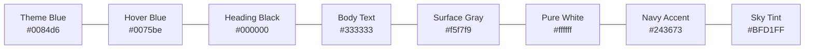
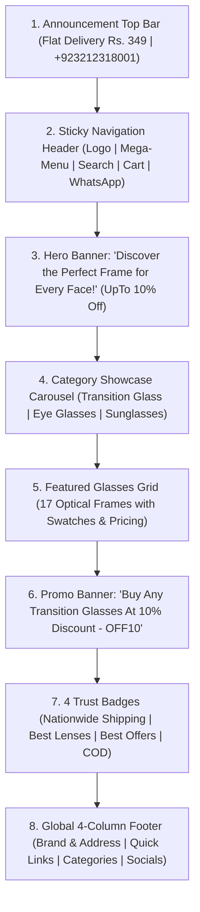
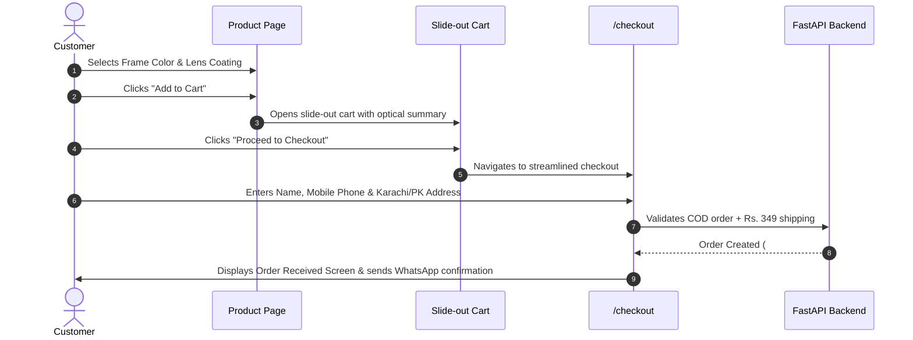

# Rida Optical — Existing Website UI/UX & Design System Analysis

> **Analysis Scope:** Complete design token extraction, layout wireframing, and interaction architecture.  
> **Source Platform:** WordPress 7.0.8 (Astra Theme + Elementor + Elementor Header/Footer Builder)  
> **Target Framework:** Next.js (App Router) + Tailwind CSS + Lucide Icons + React 19

---

## 1. Brand Identity & Design System Tokens

Extracted directly from Astra Global Palette (`global-color-palette`) and Elementor System Kits:

### A. Color Palette Design Tokens



| Token Name | Hex Code | Role in Application | Tailwind CSS Utility |
| :--- | :--- | :--- | :--- |
| **`brand-primary`** | `#0084d6` | Primary buttons, active tabs, links, brand badges | `bg-[#0084d6]`, `text-[#0084d6]` |
| **`brand-primary-hover`**| `#0075be` | Button hover states, active navigation links | `hover:bg-[#0075be]` |
| **`heading-dark`** | `#000000` | Headings (`h1` through `h6`), product titles, card titles | `text-black` |
| **`text-body`** | `#333333` | Body copy, descriptions, form field values | `text-[#333333]` |
| **`surface-bg`** | `#f5f7f9` | Page background, alternate section containers | `bg-[#f5f7f9]` |
| **`surface-card`** | `#ffffff` | Product cards, modals, checkout inputs, white surface | `bg-white` |
| **`brand-navy`** | `#243673` | Top notification bar, footer background accent | `bg-[#243673]` |
| **`sky-tint`** | `#BFD1FF` | Subtle focus rings, chip active states, banner accents | `bg-[#BFD1FF]` |
| **`notice-alert-bg`** | `#fff3cd` | Important optical prescription warning background | `bg-[#fff3cd]` |
| **`notice-alert-border`**| `#ffeeba` | Notice banner border | `border-[#ffeeba]` |
| **`notice-alert-text`** | `#856404` | Notice banner text / warning icon | `text-[#856404]` |

### B. Typography Tokens
- **Primary Font Family:** `'Lato', sans-serif` (Integrated via `next/font/google` variable font `font-lato`).
- **Hierarchy:**
  - `h1` (Hero Display): `text-3xl md:text-5xl lg:text-6xl font-bold tracking-tight text-black`
  - `h2` (Section Titles): `text-2xl md:text-3xl lg:text-4xl font-bold text-black`
  - `h3` (Subheadings / Card Titles): `text-lg md:text-xl font-semibold text-black`
  - `body` (Standard Paragraphs): `text-sm md:text-base text-[#333333] leading-relaxed`
  - `caption` (SKU, Meta, Small Labels): `text-xs text-gray-500 font-medium`

### C. Layout & Grid Parameters
- **Maximum Container Width:** `1200px` (`max-w-[1200px] mx-auto px-4 sm:px-6 lg:px-8`).
- **Border Radius Standards:**
  - Buttons / Badges: `rounded-md` (`6px`)
  - Product Cards / Modals: `rounded-xl` (`12px`)
  - Swatch Pills / Tags: `rounded-full`

---

## 2. Official Social Assets & Store Information

Extracted from Footer Template (Post ID **1165**):

| Platform | Official URL / Contact Endpoint |
| :--- | :--- |
| **WhatsApp Support** | [`https://wa.me/message/QSJGKOLYQZCMC1`](https://wa.me/message/QSJGKOLYQZCMC1) (or direct `+923212318001`) |
| **YouTube Channel** | [`https://youtube.com/@ridaoptical?si=z2HpB9PH-HEePPMe`](https://youtube.com/@ridaoptical?si=z2HpB9PH-HEePPMe) |
| **TikTok Profile** | [`https://www.tiktok.com/@ridaoptical?_t=ZS-8yGUWwSVMPZ&_r=1`](https://www.tiktok.com/@ridaoptical?_t=ZS-8yGUWwSVMPZ&_r=1) |
| **Facebook Page** | [`https://www.facebook.com/share/15wBP14ayt/`](https://www.facebook.com/share/15wBP14ayt/) |
| **Instagram Page** | [`https://www.instagram.com/invites/contact/?utm_source=ig_contact_invite&utm_medium=copy_link&utm_content=287js48`](https://www.instagram.com/invites/contact/?utm_source=ig_contact_invite&utm_medium=copy_link&utm_content=287js48) |
| **Physical Store HQ** | Shop No. 2, Fatima Shopping Mall, Main Kasba Colony Bus Stop, Karachi, Sindh (74700) |
| **Official Email** | `ridaoptical@gmail.com` |

---

## 3. Homepage Architecture & Component Breakdown



### Homepage Components Specification

1. **Top Announcement Bar:**
   - Dark Navy background (`#243673`), white text.
   - Text: `"Flat Rate Delivery PKR 349 Nationwide across Pakistan | Order on WhatsApp: +92 321 2318001"`.
2. **Main Header:**
   - Left: Rida Optical brand logo image.
   - Center: Desktop navigation menu (Eye Glasses, Sunglasses, Contact Lenses, Lenses for Glasses, Reviews, FAQs, About, Contact).
   - Right: Search modal trigger icon, Cart Drawer toggle with live item counter badge, WhatsApp Quick Action button.
3. **Hero Banner:**
   - Video / High-res optical frames hero image.
   - Headline: `"Discover the Perfect Frame for Every Face!"`.
   - Subheadline: `"UpTo 10% Off On All Products"`.
   - CTA Buttons:
     - `Find More` (Primary Blue button -> `/store`).
     - `Shop Now` (Secondary Outline button -> `/category/eye-glasses`).
4. **Category Showcase Carousel:**
   - Smooth horizontal swipeable cards with category imagery:
     - Transition Glasses (`/category/transition-glass`)
     - Eye Glasses (`/category/eye-glasses`)
     - Sunglasses (`/category/sunglasses`)
5. **Featured Glasses Grid:**
   - Headline: `"Featured Glasses"` with stylized optical divider.
   - 4-column responsive grid (1 col mobile, 2 col tablet, 4 col desktop).
   - Product Card contains:
     - Product Thumbnail with secondary hover image preview.
     - Frame color swatch indicator dots.
     - Category label.
     - Product title.
     - Pricing in PKR (`Rs. 2,500`).
     - "Select Options" CTA button.
6. **Promotional Banner:**
   - Eye-catching banner: `"Buy Any Transition Glasses At 10% Discount, Use Code OFF10"`.
   - CTA: `Shop Now` -> `/category/eye-glasses`.
7. **Trust Badges (4 Feature Boxes):**
   - 🚚 Nationwide Delivery (PKR 349 flat delivery to all cities)
   - 👓 Best Quality Lenses (Certified single vision, bifocal & progressive)
   - 🏷️ Best Value Offers (Affordable optical pricing)
   - 🔒 Cash on Delivery (Pay upon arrival at your doorstep)
8. **Footer Layout:**
   - Column 1 (About & HQ): Brand logo, description, physical Karachi store address.
   - Column 2 (Quick Links): Home, About, My Account, Cart, Contact Us, Privacy Policy.
   - Column 3 (Categories): Eye Glasses, Sunglasses, Contact Lenses, Al Mahash.
   - Column 4 (Social Links): YouTube, TikTok, WhatsApp, Facebook, Instagram icons.
   - Copyright Bar: `"© 2026 Rida Optical. All Rights Reserved."`.

---

## 4. Product Detail Page (PDP) Layout & Interaction Model

```
+------------------------------------------+------------------------------------------+
| LEFT COLUMN: OPTICAL GALLERY             | RIGHT COLUMN: FRAME CONFIGURATOR         |
|                                          |                                          |
|  [ MAIN PRODUCT PHOTO ]                  |  Breadcrumbs: Home > Eye Glasses > Frame |
|  - High-res frame view                   |  Title: Maybach Premium Rimless Frame    |
|  - Swaps dynamically on color select     |  Price: Rs. 2,199                        |
|  - Hover zoom lens                       |  SKU: RO-5184                            |
|                                          |                                          |
|  [ THUMBNAIL CAROUSEL ]                  |  [ ! IMPORTANT OPTICAL NOTICE BANNER ]   |
|  [Angle 1] [Angle 2] [Angle 3]           |  "High cylinder / progressive notice..." |
|                                          |                                          |
|                                          |  FRAME COLOR: [ ● Silver ] [ ● Golden ]  |
|                                          |                                          |
|                                          |  OPTICAL PRESCRIPTION BUILDER:           |
|                                          |  1. Select Type: (● Prescr.) (○ Frame)   |
|                                          |  2. Vision Type: [ Single Vision (+Rs 0)]|
|                                          |  3. Lens Coating: [ Screen Premium +Rs2.6k]|
|                                          |  4. Prescription: [ Text / Upload Slip ] |
|                                          |                                          |
|                                          |  TOTAL PRICE: Rs. 4,799                  |
|                                          |  [ ADD TO CART ]   [ BUY NOW ]           |
|                                          |  [ 💬 ORDER VIA WHATSAPP ]               |
+------------------------------------------+------------------------------------------+
```

### Detailed PDP Components

1. **Color Variation Swatches:**
   - Circular color pills showing exact hex swatches (`#000000`, `#aa7627`, `#81d742`, or dual-tone gradients).
   - When clicked:
     - Updates active selected color.
     - Instantly swaps main image view to that specific color variant photo.
     - Updates SKU and stock status.
2. **Important Optical Notice Banner (Snippet 6):**
   - Styled with warm alert styling (`#fff3cd` background, `#ffeeba` border, `#856404` text):
     > **Important Note:** If your prescription has a high cylinder (above ±2.00) or requires bifocal/progressive lenses, please contact us via WhatsApp for a customized quote. For single vision glasses, simply follow the steps below.
3. **Interactive Optical Prescription Builder:**
   - Step 1: `Choose Type` (With Prescription vs Frame Only).
   - Step 2: `Vision Usage` (Single Vision, Bifocal Round, Bifocal D, Progressive).
   - Step 3: `Lens Coating & Treatment` (Clear, Blue-cut Screen, Transition, Drive, Unbreakable) with live surcharge preview (+Rs. 1,300 to +Rs. 3,500).
   - Step 4: `Prescription Input` (Manual SPH/CYL/AXIS input fields + doctor slip file upload).
4. **Primary CTA Trio:**
   - `Add to Cart` (Adds frame + selected optical lens payload to slide-out cart).
   - `Buy Now` (Bypasses cart, directly navigates to checkout).
   - `Order via WhatsApp` (Compiles selected frame, color, lens coating, and total price into a formatted WhatsApp link to `+923212318001`).

---

## 5. Persistent Floating Elements

1. **Floating WhatsApp Chat Button:**
   - Position: Fixed bottom right (`bottom: 24px`, `right: 24px`).
   - Appearance: Green WhatsApp bubble with pulse animation.
   - Click Action: Opens direct conversation with `+923212318001`.
2. **Floating Review Badge (Snippet 7):**
   - Position: Fixed left edge vertically oriented (`top: 40%`, `left: 0`).
   - Appearance: Royal blue background (`#007bff`), white text, vertical orientation (`writing-mode: vertical-rl`).
   - Text: `⭐ Reviews ⭐`.
   - Click Action: Navigates to `/review-gallery`.

---

## 6. Cart & Checkout User Journey


