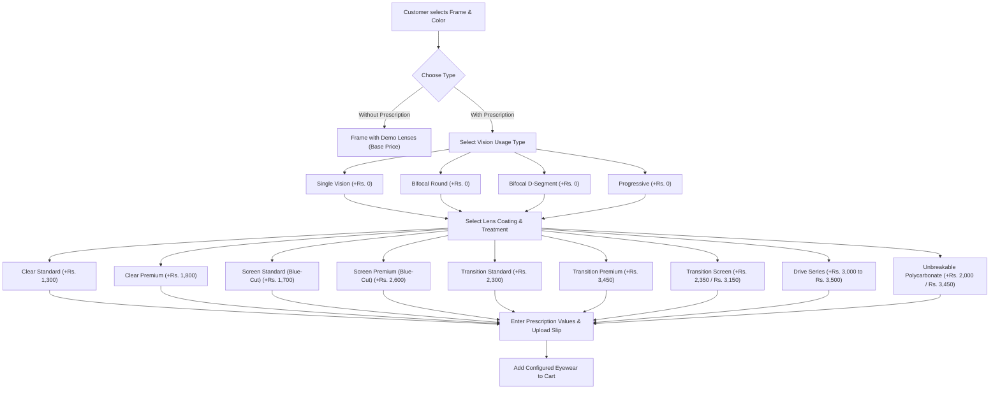

# Rida Optical — WooCommerce Data Architecture Analysis

> **Analysis Scope:** Deep architectural audit of WooCommerce catalog, variations, optical fields, shipping, and checkout data.  
> **Source Platform:** WooCommerce 11.2.1 on WordPress 7.0.8  
> **Target Platform:** Next.js (App Router) + FastAPI (Python `app/`) + Neon PostgreSQL

---

## 1. Executive Summary & WooCommerce Profile

| Parameter | Source WooCommerce Value | Target Stack Architecture |
| :--- | :--- | :--- |
| **Active Catalog Products** | **18 published products** | Relational `products` table in Neon PostgreSQL |
| **Child Variations** | **44 variation items** | Relational `product_variants` table |
| **Product Structure** | **100% Variable Products** | Clean normalized schema (Parent product + Color variations) |
| **Primary Variation Axis** | **Frame Color (`pa_color`)** | Tailwind CSS swatch selector with hex code preview |
| **Optical Engine** | **WAPF (Post ID 4620)** | Next.js interactive Optical Prescription Builder |
| **Store Currency** | **PKR** (Pakistani Rupee, Left Symbol) | Formatted as `Rs. X,XXX` |
| **Tax Policy** | **Disabled** (`calc_taxes: no`) | Prices displayed and billed inclusive of all duties |
| **Shipping Policy** | **Flat Rate: PKR 349** nationwide | Automated delivery calculation across Pakistan |
| **Payment & Checkout** | **Cash on Delivery (COD) + WhatsApp** | Multi-channel: Next.js checkout form + WhatsApp order trigger |
| **Physical Store HQ** | **Fatima Shopping Mall, Karachi** | Displayed on Contact page, footer, and LocalBusiness schema |

---

## 2. Product Catalog & Variation Matrix

Every product in the Rida Optical catalog is modeled as a parent optical frame with child variations representing frame color options with dedicated thumbnail photography.

| Product ID | Product Title | Base Price | Variations Count | Frame Color Variants (`attribute_pa_color`) | Primary Category |
| :--- | :--- | :--- | :--- | :--- | :--- |
| **4634** | **Fashion Eye Glasses** | Rs. 2,500 | 4 variations | Green, Gray, Brown, Default | Eye Glasses / Trending |
| **4800** | **Vintage** | Rs. 1,999 | 2 variations | Golden-Black, Silver-Black | Eye Glasses / Men's |
| **4820** | **Fashion Sunglasses** | Rs. 1,499 | 2 variations | Transparent, Gloss | SunGlasses / Fashion |
| **5036** | **SAPPHIRE** | Rs. 1,499 | 4 variations | Pink, Gray, Brown, Transparent | Eye Glasses / Women's |
| **5098** | **Gtayoti Cateye** | Rs. 999 | 3 variations | Pink, Brown, Green | Eye Glasses / Women's |
| **5168** | **Vison Fashion** | Rs. 1,600 | 2 variations | Silver-Black, Golden-Black | Eye Glasses / Men's |
| **5170** | **Vison Fashion - Silver Black** | Rs. 1,600 (Sale) | 0 (Standalone) | Silver-Black | Eye Glasses / Men's |
| **5184** | ***Maybach Premium Rimless Frame** | Rs. 2,199 | 2 variations | Brown-Golden, Silver-Black | Eye Glasses / Men's |
| **5219** | **Perfect — Metal Flexible** | Rs. 1,599 | 3 variations | Gray, Brown, Black | Eye Glasses / Men's |
| **5228** | **FlexiFold** | Rs. 1,299 | 3 variations | Blue, Purple, Pink | Eye Glasses / Reading |
| **5235** | **FlexiFold Model 2** | Rs. 1,299 | 2 variations | Blue, Purple | Eye Glasses / Reading |
| **5240** | **FlexiFold Model 3** | Rs. 1,299 | 3 variations | Blue, Pink, Purple | Eye Glasses / Reading |
| **5253** | **Perfect** | Rs. 1,599 | 4 variations | White, Gray, Brown, Orange | Eye Glasses / Trending |
| **5262** | **Ray-Ban Aviator** | Rs. 1,750 | 2 variations | Black, Gloss | SunGlasses / Aviator |
| **5272** | **Maybach** | Rs. 2,199 | 3 variations | Brown, Blue, Black | Eye Glasses / Men's |
| **5282** | **Cartier Wooden** | Rs. 3,999 | 2 variations | Selver, Golden | Eye Glasses / Men's |
| **5288** | **Mont Blank** | Rs. 2,400 | 2 variations | Gray, Black | Eye Glasses / Men's |
| **5296** | **Monk Blank Edition** | Rs. 2,400 | 1 variation | Black | Eye Glasses / Men's |

---

## 3. Frame Color Swatch System (`pa_color`)

Extracted from `wp_termmeta` (`cfvsw_color` from CartFlows Variation Swatches):

### A. Solid Colors with Verified Hex Codes
| Term ID | Color Name | Slug | Hex Code | Visual Swatch Preview |
| :--- | :--- | :--- | :--- | :--- |
| **106** | Aqua | `aqua` | `#1fb1c1` | `background-color: #1fb1c1` |
| **107** | Black | `black` | `#000000` | `background-color: #000000` |
| **108** | Blue | `blue` | `#1e73be` | `background-color: #1e73be` |
| **109** | Brown | `brown` | `#aa7627` | `background-color: #aa7627` |
| **113** | Green | `green` | `#81d742` | `background-color: #81d742` |
| **117** | Orange | `orange` | `#f49922` | `background-color: #f49922` |
| **119** | Purple | `purple` | `#ce25e8` | `background-color: #ce25e8` |
| **120** | Red | `red` | `#ce592f` | `background-color: #ce592f` |
| **125** | Yellow | `yellow` | `#eac820` | `background-color: #eac820` |

### B. Dual-Tone & Specialty Optical Finishes
| Term ID | Optical Finish / Color | Slug | Recommended Next.js Swatch Representation |
| :--- | :--- | :--- | :--- |
| **172** | Golden Black | `golden-black` | Linear gradient: `linear-gradient(135deg, #d4af37 50%, #000000 50%)` |
| **173** | Silver Black | `silver-black` | Linear gradient: `linear-gradient(135deg, #c0c0c0 50%, #000000 50%)` |
| **179** | Brown Golden | `brown-golden` | Linear gradient: `linear-gradient(135deg, #aa7627 50%, #d4af37 50%)` |
| **171** | Transparent Metal | `transparent-metal` | Semi-transparent frosted glass border with metallic rim |
| **174** | Transparent | `transparent` | Frosted clear glass (`#ffffff80` with dark border) |
| **175** | Gloss | `gloss` | High-shine glossy black (`#111111` with gloss highlight) |
| **163** | Golden | `golden` | Metallic gold: `#d4af37` |
| **164** | Selver (Silver) | `selver` | Metallic silver: `#c0c0c0` |
| **112** | Gray | `gray` | Neutral optical gray: `#808080` |
| **118** | Pink | `pink` | Pastel optical pink: `#f4c2c2` |
| **122** | White | `white` | Clean white: `#ffffff` |

---

## 4. Optical Lens & Customization Workflow (WAPF Integration)

When a customer configures eyewear on [ridaoptical.com](https://ridaoptical.com), the pricing and options follow this exact sequential multi-step logic:



---

## 5. Shipping Configuration & Nationwide Rates

- **Country Location:** Pakistan (`PK:SD` store base)
- **Shipping Zone:** `pakistan` (Zone ID 1)
- **Active Method:** `flat_rate` (Method ID 2)
- **Nationwide Shipping Cost:** **PKR 349**
- **Free Shipping Threshold:** None configured (Flat delivery fee of Rs. 349 applied to all orders).

---

## 6. Checkout Channels & Customer Interaction

Rida Optical operates with two primary customer purchasing workflows:

### Channel A: Next.js On-Site Checkout (Cash on Delivery)
1. Customer configures frame + color + optical lenses.
2. Navigates to `/checkout`.
3. Fills in customer details:
   - Full Name
   - Phone Number (mandatory for courier confirmation)
   - Shipping Address & City (Karachi, Lahore, Islamabad, etc.)
4. Subtotal + Rs. 349 Shipping Fee calculated.
5. Order placed with status `Processing` / `Pending Payment (COD)`.

### Channel B: Direct WhatsApp Order Dispatch
- Integrated via `click-to-chat-for-whatsapp` targeting store contact **`+923212318001`**.
- "Order via WhatsApp" button on PDP compiles a pre-filled WhatsApp message:
  ```text
  Hello Rida Optical!
  I would like to order:
  Product: Maybach Premium Rimless Eyeglass Frame
  Color: Silver Black
  Lens: Screen Premium (Blue Cut)
  Price: Rs. 4,799
  Here is my delivery details: [Customer Name, City, Phone]
  ```

---

## 7. Physical Store Headquarters (LocalBusiness Metadata)

- **Store Name:** Rida Optical
- **Address Line 1:** Shop No. 2, Fatima Shopping Mall
- **Address Line 2:** Main Kasba Colony Bus Stop
- **City / State:** Karachi, Sindh
- **Postal Code:** 74700
- **Country:** Pakistan
- **WhatsApp / Phone:** `+923212318001`
- **Official Email:** `ridaoptical@gmail.com`
